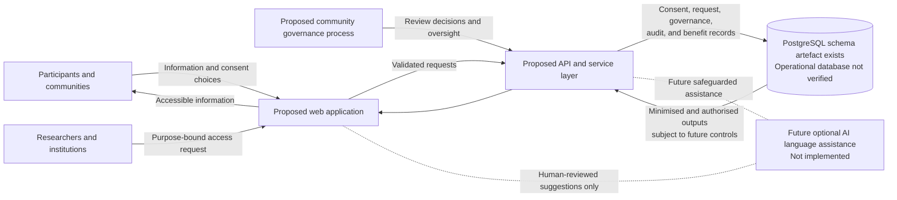

# Proposed architecture

## Status and scope

This document describes a possible target architecture, not an implemented system. The original baseline database migration is stored in `database/migrations/001_initial_schema.sql` (defining six core relational tables with Row-Level Security enabled, but containing no explicit `CREATE POLICY` statements). Subsequent local development includes Phase 2A synthetic mock fixtures and unit tests (`scripts/generate_synthetic_fixtures.py`, `synthetic_fixtures/`, `tests/test_schema.py`) and a Stage B review package (`database/stage-b-review/`). The complete current database security posture cannot be inferred from the original baseline migration alone.

In the Supabase development project `acdt-dev`, the project owner reported development checkpoint results: the Stage B migration was committed, a transaction-and-rollback security rehearsal reported 52 passing sequential assertions, five checked Stage B tables were confirmed present after commit, and the first platform governor was appointed (with saved role and active profile verified in a separate query). These database commits are distinct from Git commits; the local Stage B files remain uncommitted to Git at this checkpoint.

These reported checkpoints do not constitute an independent security certification, comprehensive audit coverage, or evidence of production readiness. The local `apps/web` directory is currently an empty placeholder; no implemented web application, API layer, or end-to-end application sign-in workflow has been established. Furthermore, complete consent and revocation handling, decision-to-grant consistency, consent-aware data release, and benefit-sharing workflows are not established by the Stage B checks. Prototyping must never process real participant or sensitive community research data. See the [implementation status register](implementation-status.md).

Any architecture that handles personal or sensitive data requires community input, threat modelling, technical testing, and qualified legal and data‑protection review before deployment.

## Proposed layers

### Web application

**Proposed; not implemented.** A future web interface could support participant‑facing consent information, institutional research requests, governance review, and community visibility into approved commitments and decisions. Interfaces should be accessible, usable on low‑bandwidth devices, and tested with intended users. The interface must not be treated as proof of consent or authority without an approved process behind it.

### API and service layer

**Proposed; not implemented.** A server‑side service layer should validate inputs, authenticate actors, enforce authorization and purpose restrictions, record security‑relevant events, and coordinate database operations. Sensitive operations should not rely on client‑side checks. No API routes, service code, or application validation currently exist.

### PostgreSQL data layer

**Partially represented in baseline and local development scripts.** The original baseline migration (`001_initial_schema.sql`) defines six core relational tables and enables Row‑Level Security (RLS) on them, but contains no explicit `CREATE POLICY` statements. Subsequent local Stage B review scripts (`database/stage-b-review/`) define additive profile, organization-trust, membership, and platform-role structures with security definer functions. In the project-owner-reported `acdt-dev` database checkpoint, Stage B DDL was committed and rehearsal assertions passed, but end-to-end application integration, full workflow enforcement, and verified production deployments remain future work.

## Proposed data and workflow concepts

- **Consent management:** `consent_records` contains consent version, preference, status, and revocation‑related columns. Future workflows would need to present understandable choices, record evidence and context, support withdrawal, and ensure downstream access respects current consent. Those workflows and enforcement are not implemented.
- **Participant pseudonymisation:** `participants` includes `participant_pseudo_id` and `contact_token_hash`. These columns do not demonstrate a pseudonymisation process, a separate identity store, or protection against re‑identification. A future design should avoid storing direct identifiers in research datasets and define how any linking information is isolated and controlled.
- **Research access requests:** `access_requests` records proposed requester, institution, purpose, cohort, data tier, review status, and expiry. It is not connected to an approval workflow or a technical access grant.
- **Governance and audit records:** `governance_audit_logs` provides a table for event‑like records. The migration adds rules that suppress updates and deletes to that table. There is no verified event capture, privileged‑role threat model, independent integrity control, monitoring, or audit review process.
- **Community benefit‑sharing:** `benefit_sharing_commitments` represents proposed commitments and delivery details. No workflow, verification process, community feedback mechanism, or dashboard is implemented.
- **Future AI‑assisted multilingual support:** Translation or plain‑language assistance could be evaluated later, with community review, privacy limits, provenance, human oversight, and no autonomous consent or research approval. No AI provider or integration is currently configured.

## Diagram

All components other than the existing schema artefact are proposed. Arrows indicate a possible flow, not current integrations.

## Security boundaries and design requirements

Before any real data use, the design must specify identity and role verification, authorization rules, explicit and tested RLS policies, key management, encryption configuration, retention and deletion, audit integrity, backup protection, incident response, and operational ownership. The baseline migration's enablement of RLS without explicit policies does not provide a complete access‑control design, and while Stage B checks validated database-level RPC security assertions in development, complete application-level access control and workflow enforcement have not been established. These topics are further described in [privacy and security principles](privacy-and-security.md).