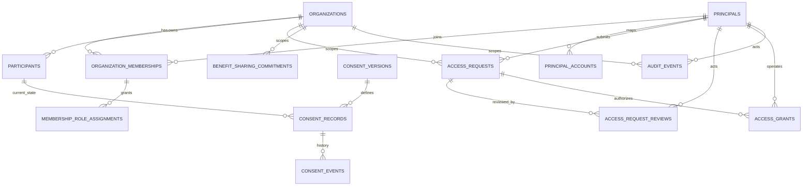
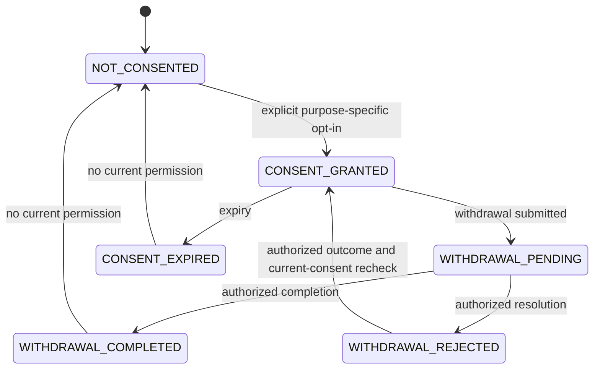

# ACDT M1 Database and Security Design

**Status:** PROPOSED — design only; not implemented or approved for real-data use

**Project:** Africa Community Data Trust (ACDT)

**Data boundary:** Verified synthetic data only
**Review date:** 2026-11-13

## 1. Executive summary

ACDT is an early-stage, open-source initiative exploring community-centred data governance. It is not an operational data trust, an established community governance authority, or an approved research platform. The repository contains one PostgreSQL-oriented migration and documentation, not an application or verified database.

This design proposes a fail-closed data model and security boundary for a future, isolated synthetic-data MVP. It accounts for all six existing tables; separates current consent state from consent history; adds explicit membership, review, grant, and audit history; defines a request-to-grant separation of duties; and specifies organization isolation, database roles, RLS policy intent, audit transactions, synthetic fixtures, and security tests.

Several decisions remain OPEN and require legitimate human authority. In particular, person-level reviewer/operator separation cannot be proven by merely creating two accounts, and a transaction-local PostgreSQL setting is not a trusted identity assertion. The design therefore recommends a database-verifiable, short-lived identity assertion from a separately controlled authorization component, with a trusted per-user database identity as an alternative if that assertion cannot be safely implemented. A custom PostgreSQL setting alone is not an acceptable proof of identity.

**Design-readiness conclusion: READY WITH CONDITIONS.** This means the proposal is ready for owner, security, privacy, and governance review. It is not implementation approval, production readiness, legal compliance, community approval, or permission to process real data. The existing migration’s embedded sample rows remain **NOT APPROVED** for reuse; the separate [M0.2 assurance review](m0-synthetic-fixture-assurance.md) documents why.

## 2. Scope and limitations

### In scope

- Conceptual relational design for the six existing tables and justified additions.
- Consent and withdrawal states, grant invalidation, separation of duties, trusted tenant context, RLS, database privileges, audit behavior, and test acceptance criteria.
- A local, isolated PostgreSQL-backed synthetic-data MVP as the proposed security-test target.
- Open decisions and legal, privacy, ethics, and community gates.

### Out of scope

- Executable SQL, migrations, policies, application code, authentication configuration, database setup, tests, seed files, or deployment.
- Real participant, health, personal, or community data; genuine consent or signature evidence; actual research authorization; real partnerships or benefit agreements.
- A legal opinion, compliance determination, security certification, or approval of a pilot.
- Any routing, link, or deployment change.

This document records proposed designs, not operational controls. No SQL or tests were run, and no database or external service was connected.

## 3. Current-state findings

### Repository evidence

The source repository is on branch `acdt-phase1-foundation` at commit `21ce6838e4dcb595fe68e2827356c0518e5452c7`. The working tree has a pre-existing modified `README.md` and pre-existing untracked Phase 1 and design documents. No application source, API, authentication implementation, database connection, explicit RLS policy, test suite, or deployment was found.

The current branch and commit match those in the supplied backup. However, the backup’s Git status does not include `docs/m0-synthetic-fixture-assurance.md`, which is present in the source working tree. The backup is therefore not a complete snapshot of the current working tree. It was not modified. Refresh and verify a full backup before any implementation or migration work.

### Existing migration

The migration defines six tables: `organizations`, `participants`, `consent_records`, `access_requests`, `governance_audit_logs`, and `benefit_sharing_commitments`. It enables RLS on all six, but contains no `CREATE POLICY` statements.

Observed design risks include:

- `allow_research_use` defaults to `TRUE`, and consent status defaults to `ACTIVE`; missing input can look affirmative.
- Consent, request, and benefit states are free-form text without comprehensive state or cross-field integrity constraints.
- Organization, participant, and benefit/request relationships use cascading deletes that can remove historical records.
- `access_requests.reviewed_by` is free text and does not model a separate reviewer decision history or an independently executed grant.
- There is no trusted principal, account-to-person mapping, organization membership, role assignment, or access-grant table.
- The audit actor is free text. Update/delete suppression rules silently discard some statements; they do not prove audit integrity or protect against privileged operators.
- There is no verified identity proofing, consent verification, encryption/key management, retention/deletion workflow, or application authorization.
- Embedded sample records have unverified provenance and are not approved for prototype or demonstration use. See [M0.2 Synthetic Fixture Assurance Review](m0-synthetic-fixture-assurance.md).

### Protected links

This design proposes no routing, hosting, URL, or deployment changes. Preserve the exact known URLs in the [protected-link inventory](phase-2-technical-specification.md#protected-link-preservation-requirement). That inventory is not exhaustive of URLs sent outside the repository. Do not infer that a link is unused because it is absent from the source tree. Any future change that might affect a known or emailed URL requires explicit owner approval; if preservation cannot be established, stop and report rather than changing or redirecting it.

## 4. Proposed database architecture

All changes in this section are conceptual. No migration or executable SQL is authorized.

### Design principles

1. Use PostgreSQL as the reference database for RLS and role tests. A UI mock-up or SQLite test is not evidence that PostgreSQL policies work.
2. Keep the synthetic MVP local and isolated: the existing Phase 2 proposal is a local Next.js application with a server-only service layer and local PostgreSQL. Do not configure production credentials or connect to a hosted database.
3. Use explicit opt-in, append-only decision history, server-side authorization, and transactionally coupled audit events.
4. Make the tenant relationship explicit on organization-owned rows. Use composite foreign keys or equivalent checks so a child row cannot reference a parent in a different organization.
5. Prefer `RESTRICT`/`NO ACTION` for historical relationships. Use explicit state changes and a reviewed retention/deletion process instead of cascading deletion of consent, review, grant, or audit history.
6. Do not make a table name, a `fixture` label, RLS enablement, or a status field a substitute for authorization.

### Existing table: `organizations`

- **Purpose and tenant:** Organization root for tenant-owned records. The row itself has no parent tenant.
- **Current key and fields:** `id UUID` primary key with generated default; `name` and `slug` required; `slug` unique; `registration_number` nullable; `country` nullable with a `Nigeria` default; timestamps nullable with `NOW()` defaults. There are no explicit checks.
- **Proposed constraints and indexes:** Keep a primary key and unique normalized slug. Add a constrained lifecycle state such as `ACTIVE`/`SUSPENDED`; validate slug format and nonblank name. Keep a unique slug index; add other indexes only for measured filters.
- **Relationships:** Referenced by participants, access requests, and benefit records. Replace destructive cascades with restrictive references.
- **Nullability and retention:** Avoid a default country that asserts a real jurisdiction in test records. Permit nullable context only where justified. Archive/suspend rather than physically delete where linked history exists; retention duration is OPEN.
- **Audit:** Record creation, status changes, and authorized metadata changes. Do not permit a routine administrator to silently transfer tenant ownership.

### Existing table: `participants`

- **Purpose and tenant:** Minimal synthetic participant/persona record; tenant is derived from `organization_id`.
- **Current key and fields:** `id UUID` primary key; required `organization_id` foreign key with `ON DELETE CASCADE`; globally unique required `participant_pseudo_id`; nullable demographic cluster/contact-token hash; language default; active flag default; created timestamp default.
- **Proposed constraints and indexes:** Use a tenant-scoped unique key such as `(organization_id, participant_pseudo_id)`; constrain lifecycle state and fixture marker. Index the organization foreign key and expected scoped lookup key. Avoid indexing unnecessary demographic fields.
- **Relationships:** Consent belongs to a participant. Add a composite tenant-aware foreign key so consent cannot refer across organizations.
- **Nullability and retention:** Do not store direct identifiers or a contact-token hash unless its purpose, linkage store, key handling, and access are separately designed. Remove unnecessary demographic fields. Deletion must not cascade through consent or audit history; use a restricted lifecycle/retention process.
- **Audit:** Record authorized create, deactivate, and fixture reset events without logging participant narratives or sensitive attributes.

### Existing table: `consent_records`

- **Purpose and tenant:** Current effective consent projection for a synthetic participant, protocol, and purpose; tenant is derived from the participant.
- **Current key and fields:** `id UUID` primary key; required participant FK with cascade; required protocol/version; consent booleans with mixed defaults; status default `ACTIVE`; nullable revocation fields; timestamp default `NOW()`; required signature-hash text. No unique or state-consistency checks are defined.
- **Proposed constraints and indexes:** Make every permission `NOT NULL DEFAULT FALSE`; represent a purpose explicitly; constrain state and valid state combinations. Use a unique current-state key such as `(participant_id, protocol_id, purpose)` if one current projection is retained. Index participant/protocol/purpose and active-state lookups.
- **Relationships:** Reference a reviewed consent version. Keep immutable consent events separately; do not overwrite the event history when updating the current projection.
- **Nullability and retention:** A grant requires a valid, explicit, unexpired affirmative event. Missing, invalid, expired, pending, or conflicting state denies. Do not store fabricated signatures or a hash that could be mistaken for verification. A database timestamp does not prove a consent act.
- **Audit:** Consent choices, withdrawal submissions, outcomes, expiry, and grant consequences produce separate events in the same transaction as the effective-state change. Deletion and event retention are OPEN.

### Existing table: `access_requests`

- **Purpose and tenant:** A requester’s bounded request for a defined synthetic dataset and purpose, owned by an organization.
- **Current key and fields:** `id UUID` primary key; required organization FK with cascade; required free-text requester name/institution, project title, purpose, and data tier; nullable cohort, reviewer, notes, and expiry; status defaults to `PENDING_REVIEW`; timestamps default to `NOW()`. There are no status checks, request-actor identity FK, or decision-history relation.
- **Proposed constraints and indexes:** Replace requester identity text as authority with an authenticated `principal_id`/membership reference. Constrain status, duration, and tier; require nonblank purpose and a valid expiry relationship. Index `(organization_id, status, created_at)` and requester/state lookups. Add an idempotency key with a documented uniqueness scope.
- **Relationships:** Add `access_request_reviews` and at most the appropriate scoped `access_grants` relation. Approval is not a grant. Use restrictive foreign keys; do not cascade-delete requests with audit history.
- **Nullability and retention:** Required request fields and reviewer outcome rules depend on state; draft-only fields may be incomplete but cannot enter review. Retention and deletion are OPEN.
- **Audit:** Record submission, amendment, withdrawal, review, decision, grant linkage, and denied attempts. Do not copy full request narratives into general logs.

### Existing table: `governance_audit_logs`

- **Purpose and tenant:** Current event-like schema only; it is not a verified audit service.
- **Current key and fields:** `id UUID` primary key; optional request FK; required free-text actor/action/purpose hash; impacted-row count default; optional IP hash; JSON metadata default; timestamp default. No actor, organization, or state-transition FK/constraints/indexes are defined. Update/delete rules suppress operations rather than providing independent integrity.
- **Proposed constraints and indexes:** Replace or formally evolve it into `audit_events` with typed actor, role snapshot, tenant, event, target, time, outcome, correlation, and minimal reason fields. Index `(organization_id, occurred_at)`, `(actor_principal_id, occurred_at)`, and `(target_type, target_id, occurred_at)` as justified. Do not index unnecessary sensitive metadata.
- **Relationships:** Use restrictive actor/organization references where possible. Polymorphic target identifiers are not database-enforced FKs; document and validate them. Retain access-request references where useful without cascading.
- **Nullability and retention:** A security event must not silently disappear because its target record is deleted. Set explicit retention and access rules with legal/privacy review; indefinite retention is not assumed.
- **Audit:** The table is the proposed audit record destination, not independent proof of event truth. Ordinary roles get append-only rights; privileged administrator risk remains.

### Existing table: `benefit_sharing_commitments`

- **Purpose and tenant:** Synthetic illustration of a proposed commitment, not evidence that a community or partner agreed.
- **Current key and fields:** `id UUID` primary key; required organization FK with cascade; required title/type/lead-partner/target-community strings; status defaults to `IN_PROGRESS`; optional target date/notes; created timestamp default. No checks, unique constraints, or supporting indexes beyond the primary key.
- **Proposed constraints and indexes:** Do not default to a state that implies work is underway. Require an explicit state such as `TEST_PROPOSED` for fixtures; constrain state/type. Index `(organization_id, status)` where used.
- **Relationships:** Use fictional labels/aliases for the MVP. A real community/partner registry is not proposed without legitimate governance authority and purpose. Use restrictive references if future normalized entities are approved.
- **Nullability and retention:** Do not use real counterparties, locations, delivery dates, or agreement terms. Avoid hard deletion after a recorded decision; retention is OPEN.
- **Audit:** Record proposal edits and simulated state changes. Never label a test record as agreed, funded, delivered, or verified.

### Proposed additional tables

| Proposed table | Need and key relationships | Constraints, tenant, and audit considerations | Complexity / alternative |
|---|---|---|---|
| `principals` | Stable internal identity for one individual; primary key `principal_id`. Referenced by accounts, memberships, requests, reviews, and grants. | Store no unnecessary personal profile. A verified identity authority must bind one person to one principal; this is not inferred from account count. Fixture principals are explicitly synthetic. Audit identity-link changes under restricted access. | Essential for person-level separation. If no approved identity authority exists, deny privileged grants rather than assuming two accounts are two people. |
| `principal_accounts` | Maps one or more authenticated account subjects to a principal. `auth_subject` is unique and FK to `principals`. | No passwords or provider secrets. Account lifecycle is active/revoked; multiple accounts for the same person map to the same principal. Change history is audited. | Essential to detect two accounts belonging to one person. Identity provider and account-linking assurance are OPEN. |
| `organization_memberships` | Binds a principal to an organization, one row per `(organization_id, principal_id)`. | Active/suspended/revoked state and validity dates; tenant-scoped unique key; index by principal/state and organization/state. Role assignment requires active membership. Membership changes are audited. | Essential. Do not infer membership from a client-supplied organization ID. |
| `membership_role_assignments` | Assigns a role to a membership; FK to membership, unique membership/role/valid assignment. | Constrain role vocabulary; track assignment and revocation actors/times. No role grants access solely by name; per-request person-level checks still apply. | Recommended to separate membership lifecycle from roles. A single-role membership row is a simpler alternative but complicates multi-role users and revocation. |
| `consent_versions` | Catalogs immutable protocol/purpose information versions referenced by consent events. | Unique protocol/version/purpose; version content or artifact reference must be controlled and reviewed. Do not represent legal approval through a database flag. Audit publication/supersession. | Recommended if versioned information is shown. A fixed synthetic protocol fixture is simpler for a UI-only mock-up but cannot validate version lifecycle. |
| `consent_events` | Append-only history of grants, withdrawal requests, outcomes, expiry, and reinstatement-related consent decisions. FK to participant, consent version, and actor. | Constrain event/state types; record purpose, effective time, and source. Derive current effective state rather than mutating history. Tenant is derived and validated through the participant. | Essential for history and transitions. Use the current `consent_records` row as a projection, not the sole evidence. |
| `access_request_reviews` | Append-only decision history for a request; FK to request and reviewer principal/membership. | Constrain decisions and state transitions; required decision time, rationale code, and conflict/recusal outcome. Requester cannot review own request. Audit reviewer identity and role. | Essential; a single `reviewed_by` field cannot represent changes, multiple reviews, or appeals. |
| `access_grants` | Separately scopes technical access after review; FK to request, approving review/decision, organization, and operator principal. | Constrain `PENDING`, `ACTIVE`, `SUSPENDED`, `REVOKED`, `EXPIRED`, `FAILED`; require scope and expiry; separate reviewer from operator principal. Index tenant/status/expiry and request. Every query revalidates current authorization. | Essential; approval alone must never expose data. External data provisioning is out of MVP scope. |
| `audit_events` | Evolves/replaces `governance_audit_logs` with typed, minimized events and append-only application privileges. | Actor and organization FKs where applicable; correlation and target indexes; no routine update/delete/truncate. External integrity protection is a later option, not assumed. | Essential as a clearer event model. Do not maintain two competing audit sources without a migration and reconciliation plan. |

No separate `communities` table is recommended for this synthetic MVP. A real community registry could imply authority, representation, or participation and requires community-led scope and governance decisions. No separate benefit-event table is required for the first synthetic slice if state changes are captured in audit events; add one only if a reviewed workflow requires independently queryable delivery history.

### Relationships and referential integrity

- One organization has many memberships, participants, requests, and synthetic benefit proposals.
- One principal can have multiple authenticated account subjects and memberships, but every account maps to the same stable principal when it represents the same individual.
- One participant can have multiple versioned consent events; the effective consent projection is derived by protocol and purpose.
- One access request can have multiple review events and at most the grants allowed by an explicitly decided renewal model.
- Every grant points to a recorded approval decision, while every operator action remains a distinct event.
- Audit events reference actors and tenant context where available. Their retention must not depend on cascade deletion of the business record.
- Use composite tenant-aware foreign keys for organization-owned references. Validate tenant equality even if application code already does so.

## 5. Entity relationship diagram

**PROPOSED.** `AUDIT_EVENTS.target_type/target_id` is a typed logical reference and is not a polymorphic database foreign key. Relationships shown do not imply that any table or control is implemented.

## 6. Consent lifecycle and withdrawal

### Proposed state definitions

| State | Meaning | Effective permission and grant behavior |
|---|---|---|
| `NOT_CONSENTED` | No valid affirmative event exists, the choice is missing/invalid, or a prior grant is no longer effective. | Deny new grants and protected queries relying on that permission. This is the default effective state. |
| `CONSENT_GRANTED` | An explicit, valid, purpose-specific affirmative choice exists for the current version and has not expired or been superseded. | May satisfy the consent condition only; it is not research approval or an access grant. |
| `WITHDRAWAL_PENDING` | A withdrawal request was received and awaits an authorized outcome. | Immediately deny new grants and suspend active grants relying on the affected permission. Suspended grants remain inaccessible. Pending is not completed withdrawal. |
| `WITHDRAWAL_COMPLETED` | An authorized reviewer approves/completes withdrawal for the recorded scope. | Mark the consent scope withdrawn and revoke affected grants. New access requires a new explicit consent event and a fresh approval/grant path. |
| `WITHDRAWAL_REJECTED` | An authorized reviewer resolves the request without completing withdrawal, with recorded scope and rationale. | The prior consent may remain effective only if otherwise valid and unexpired. Suspended grants remain suspended until a separate, explicit, authorized, recorded reinstatement decision and fresh checks. |
| `CONSENT_EXPIRED` (derived) | The applicable consent period ended. | Treat as not effective; suspend dependent grants and deny protected queries. |

### Allowed transitions

| From | To | Required actor/evidence | Access effect |
|---|---|---|---|
| `NOT_CONSENTED` | `CONSENT_GRANTED` | Explicit opt-in for each purpose, recorded against a reviewed version by an authorized synthetic actor. | Consent condition may become true; no grant is created automatically. |
| `CONSENT_GRANTED` | `WITHDRAWAL_PENDING` | Withdrawal request received and recorded. | Immediate block of new grants; suspend dependent active grants. |
| `WITHDRAWAL_PENDING` | `WITHDRAWAL_COMPLETED` | Authorized, recorded decision with scope, actor, time, and rationale code. | Revoke dependent grants; permission becomes ineffective. |
| `WITHDRAWAL_PENDING` | `WITHDRAWAL_REJECTED` | Authorized, recorded decision with scope, actor, time, and rationale code. | Do not automatically restore suspended grants. |
| `WITHDRAWAL_REJECTED` | `CONSENT_GRANTED` (effective projection only) | Re-evaluation confirms original consent remains valid, or a new explicit consent event exists. Separate grant reinstatement decision is required. | No access until all authorization checks and reinstatement are complete. |
| `CONSENT_GRANTED` | `CONSENT_EXPIRED` | Expiry condition reached; record/derive event according to the agreed model. | Suspend dependent grants and deny queries. |
| `WITHDRAWAL_COMPLETED` / `CONSENT_EXPIRED` | `CONSENT_GRANTED` | New explicit consent event under an applicable current version. | Requires a new research decision and grant; never reactivate prior grants automatically. |

No other transition is allowed by default. Failed operations, timeouts, missing reviewers, or uncertain commits leave the request pending and access suspended. Rejection/resolution is not a reinstatement event. Every transition is recorded, and security-critical state plus its audit event commit atomically or both roll back.

`WITHDRAWAL_REJECTED` is the recorded outcome for the withdrawal request. Returning the effective consent projection to `CONSENT_GRANTED` requires an authorized outcome and a recheck that the prior affirmative choice remains valid; even then, every previously suspended grant stays inaccessible until a separate, explicit grant-reinstatement decision is recorded.

Withdrawal does not automatically delete, or represent as deleted, copies, exports, backups, aggregate outputs, or derived datasets already created. Those require a separately authorized disposition decision, recipient handling plan, and legal/ethics review. No such decision or deletion capability exists in the current repository.

### Grant lifecycle coupling

Every protected query revalidates current consent, approved purpose, organization and membership state, scope, grant state, and time limits. Consent expiry, withdrawal submission, organization suspension, research-approval expiry or reversal, grant expiry, and revocation suspend/revoke access as appropriate. Any missing or inconsistent condition denies. An unauthorized grant attempt creates no grant and produces a minimized denial event.

## 7. Separation-of-duties design

These are proposed roles only. No reviewer, operator, council, appointing authority, or research approval body is established.

| Role | Permitted action | Prohibited action |
|---|---|---|
| Requester | Submit and amend own request; view own decision and grant status. | Approve or review own request; activate own grant. |
| Independent reviewer/approver | Review assigned request; record approve/reject/return outcome with rationale and conflicts. | Execute the technical grant for that request; approve a request submitted by the same person. |
| Technical operator | Execute, suspend, revoke, or expire an approved, scoped grant after revalidation. | Approve/reject research access or alter the review outcome. |

### Enforceable per-request rule

For each request, compare stable **person/principal identity**, not merely account IDs or role names:

1. Requester principal differs from reviewer principal.
2. Reviewer principal differs from technical-operator principal.
3. Each actor uses their own individually assigned, active account mapped to that principal.
4. Shared accounts are prohibited. Multiple accounts belonging to one person map to the same principal and do not satisfy separation.
5. Reviewer and operator role assignments are active for the relevant organization/request and derive from an authorized governance process.
6. The server enforces each prohibition before writing a decision or grant. The database references and audit events record each actor separately.
7. If identity mapping, active membership, or independent-person status is absent or uncertain, deny the action and leave access suspended/not granted.

The database can enforce comparisons only if a trustworthy identity authority maps accounts to stable people. The verification method and appointing authority are OPEN. Separate test principals demonstrate only simulated separation; they do not establish real-world identity.

Every decision and technical action records principal ID, account subject ID, role snapshot, organization context, action, timestamp, outcome, and correlation ID. Do not log passwords, tokens, full consent narratives, or unnecessary personal data.

## 8. Organization membership and trusted tenant context

### Required server and database flow

1. Authenticate the account using a reviewed server-side identity provider. The browser receives no database credentials.
2. Resolve the authenticated account subject to a stable principal through trusted account-link records.
3. For each protected operation, verify current organization membership and required role from server-side records. A user-supplied organization ID may select a requested context, but never proves authorization.
4. Establish a short-lived, operation-scoped tenant context without reusing it for the next pooled request. Clear/rollback context on every exit path.
5. Apply application authorization and RLS independently. The server checks actor, action, state, scope, consent, and grant; RLS limits rows even if an application query omits a tenant filter.
6. Re-check live membership and grant state for every protected query. Suspended/revoked membership fails closed; cached page/session state is not sufficient.

### Why `SET LOCAL` alone is not trusted identity

A custom setting such as `app.organization_id` or `app.user_id`, even when transaction-local, can be set by a database role that is permitted to issue the corresponding SQL. It prevents context leakage between pooled requests when used correctly, but it does not prove who the user is. A shared application role that can set an arbitrary tenant value can spoof that value if RLS trusts the setting directly.

### Viable approaches and recommendation

| Approach | Benefits | Risks/requirements | M1 design position |
|---|---|---|---|
| Browser-supplied organization ID or claims | Simple. | Untrusted client can change it; fails tenant isolation. | **Reject.** |
| Shared app role plus custom GUC only | Easy to use with a transaction pool; `SET LOCAL` limits persistence across transactions. | The shared role can set a different GUC; it is not a database-verifiable identity and can be spoofed through unsafe SQL or a compromised query layer. | **Insufficient as the sole trust boundary.** May be used only as transport for already verified context with the residual risk explicitly documented and constrained. |
| Per-user database principals through a trusted connection broker | RLS can use `current_user`/database principal tied to one identity; avoids arbitrary user-ID GUC claims. | Connection-pool partitioning, principal lifecycle, credential handling, role scale, and tenant membership updates are operationally complex. Broker must prevent the application from selecting another user role. | **Defensible alternative** if the broker and role mapping are independently tested. |
| Short-lived signed identity/tenant assertion verified by the database | The database can reject fabricated GUC contents if it verifies the signature, audience, expiry, and issuer; live membership can also be checked. | Requires a separate trusted issuer, protected signing keys, vetted database-side verification, key rotation/revocation, and careful replay/expiry handling. If the ordinary app can mint arbitrary assertions, the boundary collapses. PostgreSQL does not make arbitrary custom GUCs trustworthy by itself. | **Recommended target**, conditional on independent issuer, database-verifiable signature, live membership check, and implementation review. If unavailable, use per-user principals or do not claim independent RLS identity assurance. |

The recommended assertion contains immutable principal and account identifiers, requested organization, membership/role version, audience, issue/expiry times, and a unique request/correlation value. The trusted issuer authenticates the person and derives membership from authoritative server-side records; it never signs arbitrary browser claims. The database verifies the signature with a public key or other vetted mechanism, validates expiry/audience, and checks current active membership before RLS permits access. The signing key is not available to the browser or ordinary query role. Do not invent a cryptographic PostgreSQL extension or claim this is implemented.

### Pooling and fail-closed rules

Use transaction-scoped context only; begin a transaction, establish verified context, perform parameterized operations, then commit/rollback. Do not use session-persistent context. Test reuse of the same pooled connection for organization A and then organization B, including error and timeout paths. A missing, invalid, expired, mismatched, or revoked context denies access. If the database cannot verify the trusted context, fail closed.

## 9. RLS and database privilege matrix

### Policy intent by table

The matrix is a proposed authorization contract, not executable policy. `R` = read; `I` = insert; `U` = update; `D` = delete; `—` = denied. Operations in the **Constrained server service** column are still subject to the restricted application role and RLS; they require server-side authorization and database-verifiable context, not a bypass role. `self` means the actor’s own principal/account; `own` means the authorized organization/request scope. `D` is not granted to ordinary application roles. Organization context must be database-verifiable as described in Section 8.

| Table | Anonymous | Authenticated non-member | Organization member (no special role) | Requester | Reviewer | Technical operator | Oversight auditor | Constrained server service | Privileged admin / migration | Cross-organization |
|---|---|---|---|---|---|---|---|---|---|---|
| `organizations` | — | — | `R own` | `R own` | `R own` | `R own` | `R` only within mandate | `I/U` approved tenant metadata only | Separate maintenance; no routine application access | — |
| `principals` | — | `R self` | `R self` | `R self` | `R self` | `R self` | — | `I/U` identity mapping through controlled identity workflow | Identity service only; break-glass audited | — |
| `principal_accounts` | — | — | — | — | — | — | — | `I/U` controlled account mapping; no browser exposure | Identity service only; credentials/subjects not exposed | — |
| `organization_memberships` | — | `R self` | `R self` | `R self` | `R own` as needed | `R own` as needed | `R` minimized | `I/U` authorized membership lifecycle only | Separate maintenance; no routine application access | — |
| `membership_role_assignments` | — | `R self` | `R self` | `R self` | `R own` as assigned | `R own` as assigned | `R` minimized | `I/U` authorized role assignment only | Separate authorized role-management path | — |
| `participants` | — | — | — | — | `R` minimum eligibility fields for assigned request | `R` minimum operational fields only | `R` minimized by mandate | `I/U` synthetic workflow/fixture path only | No routine participant-level access | — |
| `consent_versions` | — | — | `R own` | `R` for own request context | `R` relevant version | `R` relevant grant condition | `R` minimized | `I` approved immutable version only | Version publication through approved path | — |
| `consent_records` | — | — | — | — | `R` minimum effective-permission result | `R` minimum grant-check result | `R` minimized | `I/U` current-state projection after valid event only | No routine data access | — |
| `consent_events` | — | `R self` | — | — | `R` minimized assigned context | — | `R` minimized by mandate | `I` append-only event after authorization | No routine mutation or deletion | — |
| `access_requests` | — | — | — | `R/I/U own` draft/returned only | `R` assigned | `R` approved minimum scope | `R` minimized | `I/U` validated state transitions only | No routine application access | — |
| `access_request_reviews` | — | — | — | `R` own outcome only | `R/I` assigned | `R` decision summary only | `R` within mandate | `I` append-only review event after SoD check | No routine mutation or deletion | — |
| `access_grants` | — | — | — | `R` own status | `R` status only | `R` own operational status | `R` minimized | `I/U` after approval, current consent, scope, membership, expiry, and SoD checks | Break-glass only, separately authorized/audited | — |
| `audit_events` | — | `R` own relevant outcome only | `R` permitted own-organization summary | `R` own request events | `R` relevant decision events | `R` operationally relevant events | `R` scoped read-only | `I` append-only; no `U/D` | Separate, tightly controlled maintenance; never ordinary app | — |
| `benefit_sharing_commitments` | — | — | `R/I/U own` synthetic proposals | — | `R` relevant proposal | — | `R` within mandate | `I/U` synthetic proposal state only | No routine application access | — |

Any omitted operation is denied. Policies must enforce both row scope (`USING`) and proposed row scope (`WITH CHECK`) for every permitted write. The application service must further check role, assignment, workflow state, purpose, and person-level separation; RLS does not implement those business decisions by itself. Sensitive participant and consent fields should be exposed through narrow views or service results, not broad table reads.

### Role and privilege boundary

| Database role | Proposed privileges |
|---|---|
| `acdt_owner` | `NOLOGIN`; owns schema/tables. Not used by application or human workflow actors. |
| `acdt_migrator` | Separate, time-limited schema-change privilege for reviewed migrations in disposable/local environments. Not used for normal requests. |
| `acdt_app` | Restricted login/connection role for ordinary application operations; not owner, superuser, or `BYPASSRLS`; no DDL, `TRUNCATE`, unrestricted delete, or ability to grant privileged roles. |
| `acdt_audit_reader` | Read-only access to minimized audit views only under an authorized oversight mandate. |
| `acdt_test` | Isolated disposable test environment only; no shared credentials or access to non-test data. |
| Break-glass DBA/superuser | Exceptional infrastructure role, not available to browser/application code; access limited, approved, and independently logged where feasible. RLS cannot protect against a superuser or equivalent privileged bypass. |

Enable RLS and, where appropriate, `FORCE ROW LEVEL SECURITY` on tenant-protected tables. `FORCE` helps subject the table owner to policies but does not neutralize superuser or `BYPASSRLS`. Test actual owner, superuser, and bypass behavior separately. Ordinary application operations must never use those credentials. No database credential may be exposed to the browser.

## 10. Audit architecture

### Proposed `audit_events` fields

| Field | Purpose and constraint |
|---|---|
| `event_id` | Unique immutable event identifier. |
| `actor_principal_id` / `actor_account_id` | Stable person and authenticated account reference; nullable only for a genuinely unauthenticated attempt, which must be marked as such. |
| `actor_role` | Role snapshot used for the operation; not trusted as the sole authorization source. |
| `organization_id` | Verified tenant context where applicable; distinguish global administrative events. |
| `event_type` | Constrained event vocabulary, not arbitrary sensitive narrative. |
| `target_type` / `target_id` | Minimal subject record reference; validate supported target types. |
| `occurred_at` | Server/database-generated UTC event time. |
| `outcome` | Success, denial, failure, or explicit pending/reconciliation outcome. |
| `reason_code` | Minimized reason for decisions/denials; detailed narrative is not required in the general audit stream. |
| `correlation_id` / `idempotency_key` | Connect related request, review, grant, retry, and transaction events without duplicating request data. |
| `transition` | State before/after or transition identifier sufficient to reconstruct workflow, without unnecessary sensitive values. |
| `metadata` | Allowlisted minimal fields only; validate schema and size. No secrets, full consent text, raw credentials, or unnecessary participant data. |

### Event coverage

Record organization/member/role changes; consent grant and version; withdrawal submission/outcome; request submission/amendment; review/approval/rejection; grant creation/activation/suspension/reinstatement/revocation/expiry; benefit proposal changes; privileged administrative actions; and authorization denials. Record actors and timestamps separately for reviewer and operator. Do not log raw IP addresses or hash them by default; any such collection requires purpose, privacy review, and retention.

### Atomicity and failure behavior

For a security-critical operation, update workflow state and insert its required audit event in the same transaction. Commit only when both succeed. If the audit insert or state write fails, roll back both and return an explicit failure; never activate a grant, report success, or retry with audit disabled. Use idempotency/correlation identifiers to resolve uncertain client timeouts before retrying. Do not silently swallow errors or return success-shaped fallbacks.

Ordinary application roles may append events through a constrained service and may not update, delete, or truncate them. A separate reader gets only minimized views. Table ownership, superuser, host access, backup access, or compromised privileged credentials remain possible tampering paths. An ordinary audit table is not tamper-proof. A separately controlled append-only destination may be evaluated later, with privacy, cost, and operational review.

## 11. Synthetic fixture architecture

The current embedded migration rows are **NOT APPROVED** and must not be copied into a prototype or future seed. The [M0.2 review](m0-synthetic-fixture-assurance.md) contains the category assessment; this document does not reproduce those unverified values.

### Proposed coherent fictional graph

Use the approved logical aliases only as fixture identifiers, not as evidence of real entities:

- `ORG-TEST-001` — `ACDT TEST ONLY — Example Organization 001`.
- `COMM-TEST-001` — `TEST COMMUNITY 001 — FICTIONAL — NO REAL LOCATION`.
- `PARTNER-TEST-001` — `TEST PARTNER 001 — FICTIONAL`.
- `P-TEST-001` and `P-TEST-002` — test-only personas with generic `TEST-COHORT-A/B`; no health or personal detail.
- `CONSENT-TEST-001` and `CONSENT-TEST-002` — explicitly not consented; each permission false; no genuine-looking signature/hash.
- `REQ-TEST-001` — synthetic purpose, explicit `TEST_NOT_APPROVED` state; positive-path scenarios remain isolated simulations.
- `BENEFIT-TEST-001` — `TEST_NOT_APPROVED` or `TEST_PROPOSED_SIMULATION`; no real agreement, delivery, or target date.

Map aliases to deterministic UUIDs from a dedicated fixture namespace only when the schema requires UUIDs. Use `example.org` addresses only when a contact value is necessary. No real registration formats, communities, partners/funders, people, health attributes, or routable contact details are permitted.

### Row and export isolation

- Use a separate disposable synthetic database and distinct test credentials. Never mix real and synthetic records.
- Add an explicit row-level fixture marker (for example `fixture_kind = SYNTHETIC_TEST`) to every fixture-bearing row, including linked records. Insert paths must set it explicitly; a default alone is not proof.
- Use a dataset label such as `SYNTHETIC TEST DATA — NOT REAL PEOPLE, COMMUNITIES, APPROVALS, OR AGREEMENTS`. Include the row marker and dataset label in every view, download, and export.
- Test export labels at the serialized row level; a UI banner alone is insufficient.
- For consent, use a conspicuous non-consent state and non-verifiable placeholder, never a hash or signature that could pass a genuine verification path.
- For simulated positive approvals, use a distinct `TEST_APPROVED_SIMULATION` state and test-only actors. The query layer must also require `fixture_kind = SYNTHETIC_TEST`; a simulated approval must never authorize non-test records.
- The current schema has no fixture marker, no fixture dataset relation, and no test-only authorization boundary. These are conceptual schema and query requirements, not implemented controls.

## 12. Security test specification

These tests are proposed for a future disposable local PostgreSQL implementation. They were not run. Every test uses synthetic records and records evidence without real identities or secrets.

| ID / scenario | Expected behavior | Security objective | Pass/fail acceptance criterion |
|---|---|---|---|
| T01 — Unauthenticated request | Deny organization-scoped read/write; no row returned. | Authentication required. | Zero protected rows and no state change; explicit denial recorded where the audit path is available. |
| T02 — Cross-organization read/write | Deny a member of organization A attempting organization B records. | Tenant isolation. | Both SELECT and write return no protected data/change for B. |
| T03 — Browser/API organization-ID spoof | Ignore or reject client-supplied organization context not authorized by server records. | Prevent client-controlled tenant selection. | Changing the ID never returns or mutates another tenant’s row. |
| T04 — Suspended/revoked membership | Deny every protected operation immediately after suspension/revocation is effective. | Enforce current membership. | Previously valid session/query now fails; no cached grant bypass. |
| T05 — Pooled connection context leak | Run tenant A then tenant B on the same pooled connection, including error/rollback paths. | Prevent context carryover. | Each request sees only its authorized tenant; post-transaction context is absent/reset. |
| T06 — Database owner, superuser, and `BYPASSRLS` | Exercise each privileged role separately and document its actual bypass behavior; verify application credential attributes independently. | Bound privileged threat and prove app is least privilege. | App role is not owner/superuser/`BYPASSRLS`; privileged access is not available to app/browser; expected admin bypass is not misrepresented as prevented by RLS. |
| T07 — Requester self-approval | Requester attempts approval using own account or another account mapped to same principal. | Enforce requester/reviewer separation. | Server rejects; no approval or grant row/event indicating success. |
| T08 — Reviewer executes own grant | Reviewer attempts technical grant for the same request. | Separate decision from enforcement. | Server rejects; no active grant; denial event is attributable. |
| T09 — Operator approves request | Technical operator attempts to approve/reject. | Operator cannot make research decision. | Server rejects; request state unchanged. |
| T10 — Missing independent reviewer | Review identity or authorized assignment is absent/uncertain. | Fail closed where authority cannot be established. | Approval and grant denied; request remains pending/blocked. |
| T11 — Missing technical operator | No distinct authorized operator can be established. | Approval alone cannot create access. | No grant activation; no protected data returned. |
| T12 — Two accounts for one reviewer/operator person | Assign different account IDs mapped to the same principal. | Enforce different individuals, not different accounts. | Separation check fails and grant is denied. |
| T13 — Shared account | Attempt privileged review or grant through a shared account. | Individual accountability. | Authentication/authorization policy rejects the shared identity for privileged action. |
| T14 — Consent omitted or invalid | Omit a purpose choice or send null/unknown value. | Explicit affirmative opt-in. | Effective permission is `NOT_CONSENTED`; grant/query denied; no implicit `TRUE`. |
| T15 — Withdrawal pending | Submit withdrawal while a dependent grant is active. | Immediate fail-closed suspension. | New grant denied and existing grant becomes inaccessible before review outcome; pending remains distinct from completed. |
| T16 — Withdrawal processing failure/timeout | Fail the decision/event transaction or make commit outcome uncertain. | No accidental state restoration. | Prior committed state is reconciled; grant remains suspended; explicit failure/pending response, no success-shaped response. |
| T17 — Grant after withdrawal submission | Attempt new grant after `WITHDRAWAL_PENDING`. | Block use of affected permission. | No grant activation; zero protected rows returned. |
| T18 — Automatic reinstatement attempt | Resolve/reject withdrawal or retry a failed operation without a separate reinstatement decision. | Prevent implicit restoration. | Grant remains suspended until explicit authorized decision and all current checks pass. |
| T19 — Audit-write failure | Force required audit insert to fail during consent/review/grant transition. | Atomic, fail-closed workflow. | Both state change and event roll back; caller receives explicit failure; no active grant. |
| T20 — Transaction rollback | Fail after state update but before event commit. | Prevent partial durable state. | Database state and required audit event both remain at prior committed state. |
| T21 — Unauthorized audit modification | App role attempts update, delete, or truncate of audit events. | Protect ordinary audit history. | Operation is denied; event count/content unchanged; privileged DBA limitations remain documented. |
| T22 — Simulated approval reaches non-test data | Use `TEST_APPROVED_SIMULATION` to query a row without the test marker. | Prevent fixture approval from becoming real authorization. | Query denies and returns zero non-test rows. |
| T23 — Export loses fixture label | Export linked synthetic records and inspect each serialized row and file metadata. | Preserve test-only meaning outside the UI. | Every exported row includes the fixture marker and dataset label; omission fails the test. |
| T24 — Approval or grant expiry/reversal | Expire or reverse approval, suspend organization, expire/revoke grant, or make consent expire. | Revalidate every authorization condition. | Subsequent query denies even with an existing session/page; transition is recorded. |

## 13. Legal, privacy, and governance gates

These are issues for qualified human review, not conclusions of this technical design. No compliance determination or approval is made.

| Gate | Review needed before real-data use or pilot |
|---|---|
| Nigeria Data Protection Act 2023 and NDPC guidance | Qualified Nigerian data-protection counsel/reviewer should assess applicability, lawful basis, notices, rights, safeguards, regulatory guidance, and any required assessment or consultation. |
| Controller/processor responsibilities | Identify the actual purposes, decision-makers, processors, sub-processors, contracts, instructions, and accountability. Technical stewardship alone does not determine legal roles. |
| Lawful basis and consent | Determine appropriate lawful basis and whether consent is required or suitable; review language, accessibility, versioning, representative authority, separate purposes, evidence, and withdrawal limitations. A database flag does not establish valid consent. |
| Data-subject rights | Define accessible routes, identity checks, response ownership, correction/access/objection/deletion handling as applicable, and protection from inappropriate disclosure. |
| Retention and deletion | Decide category-specific periods, holds, backups, audit retention, recipient copies, exports, and derived datasets. Withdrawal does not automatically delete these items. |
| Cross-border transfers | Keep cross-border processing out of the MVP. Any later transfer requires jurisdiction-specific legal, security, recipient, and community review. |
| Research ethics | Identify the competent research-ethics review and any institutional approvals required for the actual protocol. No request in this system can substitute for ethics approval. |
| Community authority and representation | Communities define legitimate representation, mandate, participation, decision rights, dispute resolution, and whether any council is appropriate. None is established. |
| Benefit-sharing | Affected communities and relevant partners determine whether and how arrangements are agreed, monitored, and reported. A benefit never substitutes for consent or acceptable risk. |
| Security operations and incidents | Establish accountable operators, incident detection/response, breach assessment and communications, access reviews, recovery, and decommissioning before use. |

Technical design choices (keys, RLS, transactions, indexes, roles) cannot decide lawful basis, community mandate, ethics acceptability, or benefit-sharing. DanYem may provide technical stewardship but must not be designed as the sole authority over community data or approvals. AI must never make consent, withdrawal, access, governance, or benefit-sharing decisions.

## 14. Open decisions register

Every item below is **OPEN**. Suggested owners are roles to be identified, not appointed people or existing authorities.

| Decision required | Why it matters | Suggested responsible decision-maker/reviewer | Blocks |
|---|---|---|---|
| Who can legitimately appoint/authorize reviewers and technical operators? | Software cannot establish governance authority or an appointment mandate. | Community-defined governance process with relevant institutional input. | Privileged workflow implementation, real-data use, and pilot. |
| How will distinct reviewer/operator people be independently established and account-linked? | Two accounts may belong to one person; person-level separation depends on reliable identity mapping. | Approved identity/authorization authority and qualified privacy/security reviewer. | Separation enforcement and any grant implementation; real-data use. |
| Who defines community representation, authority, and any council mandate? | No council or community mandate exists in the repository. | Communities concerned, through a locally legitimate process. | Governance approval, real-data use, pilot. |
| Who decides consent wording, versions, purposes, expiry, representatives, and affirmative evidence? | Technical defaults cannot establish informed consent or legal sufficiency. | Affected communities, protocol owner, research ethics, and qualified legal/data-protection reviewers. | Consent implementation; real data; pilot. |
| Who authorizes research access and under what review/quorum/conflict/appeal rules? | The reviewer role and decision rights are not currently established. | Legitimate governance authority and relevant institutional/ethics bodies. | Review and grant implementation; real-data use; pilot. |
| What does withdrawal mean for exported, copied, backed-up, aggregated, or derived data? | Withdrawal does not automatically delete downstream copies; obligations are context-specific. | Communities/participants through approved process, researcher/institution, ethics, and legal reviewers. | Real-data use and pilot; deletion workflow. |
| How long are each record class and audit event retained? | Retention and deletion conflict with historical integrity and legal obligations if invented technically. | Data controller/processor owners with qualified legal and community review. | Real-data use and pilot; production retention design. |
| How is organization membership verified, suspended, and revoked? | Browser claims and stale memberships cannot authorize access. | Named organization administrators under an agreed governance and identity process. | Tenant isolation implementation and all privileged actions. |
| Which trusted tenant-context approach is acceptable? | A shared role can spoof custom GUCs; a secure signed assertion or per-user DB principal needs independent validation. | Security architect, DBA, identity authority, and independent reviewer. | RLS design implementation and cross-organization use. |
| Which RLS policies, PostgreSQL version, role topology, and migration process are approved? | RLS is enabled but has no policies; owner/bypass behavior must be handled. | Database/security owner and independent technical reviewer. | Any migration or security claim. |
| What legal basis, NDPA/NDPC obligations, and research-ethics approvals apply? | The document cannot certify applicability or compliance. | Qualified Nigerian legal/data-protection and research-ethics reviewers. | Real-data use and pilot. |
| Are benefit-sharing commitments appropriate, and who can agree/verify them? | Existing sample values are not real agreements; benefits must be community-determined. | Affected communities and authorized counterparties. | Any real commitment or pilot. |
| What encryption/key, incident, backup, recovery, and operational responsibilities are required? | No current key management, incident response, or operations exist. | Named security/operations owner and independent reviewer. | Any non-local deployment; real-data use and pilot. |
| How is the stale supplied backup refreshed and independently verified before implementation? | Current backup Git status lacks the M0.2 assurance report found in source. | Repository owner. | Implementation/migrations; not this design-only document. |
| Could any future architecture or deployment affect an emailed URL not in the repository? | Repository inventory is not exhaustive of distributed links. | Project owner, using distribution records. | Any routing/deployment change; stop if preservation cannot be confirmed. |

## 15. M1 acceptance criteria

The following criteria define design acceptance only. They are not implementation test results.

| Criterion | Design evidence in this document | Status |
|---|---|---|
| All six existing tables accounted for | Table-by-table current/proposed assessment in Section 4. | Met as design coverage |
| Additional tables justified, alternatives/trade-offs stated | Proposed-table rationale and complexity table in Section 4. | Met as design coverage; owner review remains |
| Relationships, integrity, deletion, retention, tenant, and audit considerations described | Section 4 and ER diagram. | Met as design coverage; retention decisions OPEN |
| Consent states/transitions and withdrawal behavior explicit | Section 6 state table and diagram; failed processing remains suspended. | Met as design proposal |
| Requester/reviewer/operator separation is enforceable | Section 7 compares stable person principals, accounts, memberships, and denies uncertain separation. | Proposed; identity authority OPEN |
| Trusted organization context addresses GUC spoofing and pool leakage | Section 8 compares viable approaches and recommends database-verifiable identity. | Proposed; implementation approach OPEN |
| RLS and privileges specified for every proposed table | Section 9 matrix and role boundary. | Met as policy intent; no policies implemented |
| Audit fields, events, atomicity, and failure handling defined | Section 10. | Met as design proposal; retention OPEN |
| Synthetic-only data, row marker, and export labeling defined | Section 11; existing embedded samples excluded. | Met as design proposal; no fixtures approved or implemented |
| Required security scenarios have measurable outcomes | 24 proposed tests in Section 12. | Met as future test specification; tests not run |
| Legal, governance, privacy, and operational decisions recorded | Sections 13 and 14. | Open decisions explicitly identified |
| No real-data, legal-compliance, production-readiness, or approval claims | Scope and limitations throughout. | Met |
| Existing distributed URLs protected | Section 3 preserves the existing inventory and requires owner approval for any potential impact. | Met as design requirement; emailed inventory remains non-exhaustive |

## 16. Risks and recommendations

| Risk | Recommendation / gate |
|---|---|
| Shared app role can set arbitrary custom context | Do not trust custom GUC contents alone. Select and independently test a database-verifiable signed assertion or brokered per-user DB identity before relying on RLS for tenant isolation. |
| Person-level separation is not established by account separation | Add stable principal-to-account mapping and an authorized identity-assurance process. Deny grants when distinct people cannot be established. |
| Current consent default can imply permission | Change only through a separately approved migration; proposed defaults are explicit false and absence denies. |
| Cascading deletes may erase history | Replace with restrictive references and a reviewed retention/deletion process; do not implement deletion behavior by assumption. |
| Audit rules silently suppress updates/deletes and privileged actors remain powerful | Use explicit append-only grants and atomic event/state transactions; document administrator risk and avoid tamper-proof claims. |
| Existing seed provenance is unverified | Do not execute or reuse current rows; use only the separately reviewed fictional aliases after owner approval. |
| Synthetic approval could reach non-test data | Require test-only dataset marker in every row and query, isolation, export labels, and negative tests. |
| Supplied backup is stale relative to current source | Do not treat it as a complete current snapshot; create/verify an updated backup under a separate approved task before implementation. This design task did not modify it. |
| Emailed URL inventory may be incomplete | Preserve known exact URLs and seek owner confirmation before any future routing/deployment change. |
| Governance/legal authority is unresolved | Keep all decisions simulated; no real-data, pilot, or approval workflow until legitimate decision-makers and qualified reviewers are identified. |

## 17. Final design-readiness conclusion

**READY WITH CONDITIONS**

This document provides a coherent proposal for owner and independent technical/privacy/governance review. Conditions before design approval for implementation are: resolve the trusted identity/tenant-context approach; define how real individuals and role appointments would be authorized; obtain the required community, legal/data-protection, and research-ethics decisions; approve retention and downstream-withdrawal handling; approve the synthetic fixture standard; and refresh/verify the incomplete supplied backup.

This conclusion is only about readiness to review the design. It does **not** authorize implementation, SQL changes, migration execution, real-data use, external connections, deployment, a pilot, or production operation. Wait for explicit owner review and approval before any M1 implementation.
