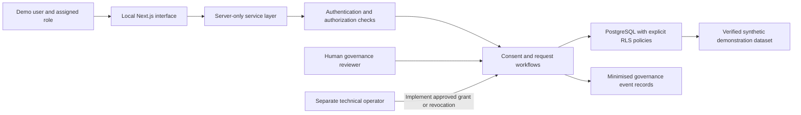
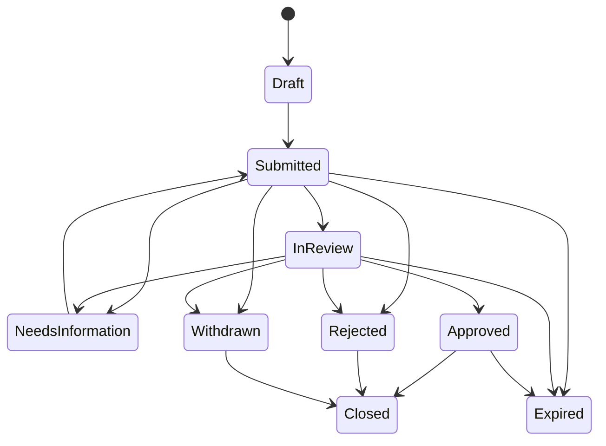

# Phase 2 Technical Specification: Synthetic-Data MVP

**Status:** Proposed design only; not implemented or approved for real-data use  
**Project:** Africa Community Data Trust (ACDT)  
**Scope:** A local, isolated demonstrator using verified fictional data only

This specification translates the repository's Phase 1 proposals into a candidate MVP design. It does not create an operational data trust, authorize research, establish a governance body, provide legal advice, or establish that any control is effective. Community and institutional decisions remain necessary before the design is adopted.

## 1. Executive summary

ACDT is an early-stage, open-source initiative exploring community-centred data governance, informed consent, responsible research access, accountability, privacy, and equitable benefit-sharing. Nigeria is the intended starting context; legal, ethical, language, and governance decisions must be reassessed for each context.

The repository currently contains documentation and one PostgreSQL-oriented migration. It has no application, authentication, application authorization, configured database, explicit row-level security (RLS) policies, automated tests, CI, or deployment. The migration's fields and rules are schema artefacts, not implemented user-facing or security controls. See the [implementation status register](../implementation-status.md).

**Recommendation:** Use a local Next.js application with a server-only service layer and a local PostgreSQL instance. Keep the prototype offline from production systems and external data services. Supabase may be evaluated later, but is not needed for this zero-budget local stage. SQLite is useful for a lightweight UI mock-up, but is not recommended as the MVP security-test database because it does not provide PostgreSQL RLS semantics.

The MVP should demonstrate organization-scoped administration, synthetic participant consent and withdrawal, research-request review by a human role, a separate technical grant/revocation step, an event record, and illustrative benefit commitments. Only synthetic records may be displayed or queried. The MVP must never independently approve consent, research, or governance decisions.

This is a **conditional design for Phase 2**, not a go-ahead for a live pilot. Before implementation, agree the roles, workflow, schema changes, threat model, fixture provenance, and local development boundaries with appropriate stakeholders. No real data, production credentials, external database, or deployment is in scope.

## 2. Current repository status

The inspected repository has:

- A project README and five design/status documents.
- One PostgreSQL-oriented migration defining six tables, enabling RLS on them, adding update/delete rules for the audit table, and inserting sample rows.
- Empty `apps/web/` and `database/seed/` directories.
- No application, authentication service, authorization layer, explicit RLS policies, migration/test process, CI, deployment configuration, or verified database.

The migration has structural gaps relevant to the MVP: `allow_research_use` defaults to `TRUE`; status and consent fields lack consistency constraints; `updated_at` has no update mechanism; organization and participant deletions cascade; seed inserts are not consistently repeatable; and the audit rules are not an independently protected audit service. RLS without policies is not a complete access-control system. The sample records are labelled synthetic, but their fictional provenance has not been verified.

Existing files and Git state must be preserved. This assignment changes no existing documentation or SQL.

## 3. Scope and non-goals

### In scope

- A local, non-production demonstrator using controlled, fictional fixtures.
- Server-side identity checks and role-based authorization for demo accounts.
- Organization-scoped views and operations.
- Explicit opt-in consent choices, versioned consent records, and a withdrawal-request flow.
- Human review of synthetic research-access requests.
- A separate technical enforcement step that grants access only to a synthetic demonstration dataset.
- Minimised event records, basic synthetic benefit commitments, and an administrative dashboard.
- Focused automated tests, including PostgreSQL RLS tests using least-privileged roles.

### Non-goals

- Real participants, health data, production credentials, real organization records, or actual community datasets.
- Real research approval, ethics review, or legal authorization.
- A deployed service, hosted Supabase project, production operation, or controlled pilot.
- A claim of legal compliance, encryption, anonymity, tamper-proof logging, or security certification.
- Autonomous decisions by AI or other software about consent, withdrawal, approval, rejection, or community governance.
- Cross-border data transfer or commercial AI training.
- A full participant identity-management or identity-linkage service.

## 4. Recommended architecture

### Options considered

| Option | Benefits at this stage | Limitations and security considerations | Cost considerations |
| --- | --- | --- | --- |
| Next.js application | Open-source framework; one codebase can provide the demo interface and server-side endpoints; suitable for a local prototype. | Server actions, route handlers, and UI controls are not authorization boundaries by themselves. Every sensitive operation must check the authenticated actor and current policy server-side. Requires JavaScript/Node tooling and careful separation of browser and server secrets. | No framework license fee. Local machine, maintenance time, and any future hosting or managed services may cost money. |
| Local PostgreSQL | Open-source relational database with foreign keys, transactions, and native RLS, so policy behavior can be tested using database roles. | Requires local installation and administration. RLS policies, service roles, owner/bypass behavior, backups, and migrations need explicit design and tests. RLS is not authentication. | No database license fee for a local instance; hardware, setup, and operator time still have costs. |
| Supabase hosted | Managed PostgreSQL plus optional authentication and other services may simplify later demonstrations. | Hosted data leaves the developer's machine. Provider configuration, region, account access, data-processing terms, RLS, service keys, backup behavior, and incident responsibilities must be reviewed. A free tier is not a security or continuity guarantee, and plan limits/prices can change. It is not currently configured. | May have a free tier, but limits and future charges can change. Do not rely on free-tier availability for an approved pilot or production. |
| Supabase local | Can exercise a Supabase-like local stack without using a hosted database. | Adds CLI, container runtime, and service-management complexity. Local behavior still needs to be checked against the exact hosted configuration if that is later selected. | Open-source components may avoid service fees; development time and machine resources remain costs. |
| SQLite or an in-memory store | Very simple setup for a UI-only mock-up or unit tests. | Does not reproduce PostgreSQL RLS, role behavior, or all relational semantics. It must not be used to claim that the MVP's tenant isolation or RLS has been validated. | No license or hosting fee; the risk is misleading test coverage if treated as equivalent to PostgreSQL. |

### Recommendation

For the first useful MVP, use:

1. A local Next.js web application.
2. A server-only application/service layer for validation, authentication checks, authorization, workflow transitions, and audit-event creation.
3. A local PostgreSQL instance using the same major version for developers and CI.
4. Explicit local database roles and RLS policies, tested independently from UI behavior.
5. Deterministic synthetic fixtures kept separate from schema migrations.

Use native local PostgreSQL where available, or a local container if the team already has a supported container runtime. Neither option should require a hosted account. Do not connect this prototype to Supabase-hosted or other external databases. No technology is installed or configured by this specification.

### Trusted organization context and PostgreSQL RLS

Organization scope must come from trusted server-side identity and membership records, never from an organization ID supplied by the browser as authority.

1. The server verifies the authenticated user's session and looks up that user's active organization membership and role in trusted records before every protected operation.
2. The browser may request an organization context for navigation, but the server must verify that the authenticated user is an active member before accepting it. Client input must not set or override authorization context.
3. For each protected database operation, the server establishes the validated user and organization context within that operation's transaction or connection scope. A proposed pooled-connection pattern is to begin a transaction, set transaction-local context from the verified server-side records (for example, with PostgreSQL `SET LOCAL`), execute parameterized queries under RLS, then commit or roll back. Do not use persistent session-level context that can leak to the next borrower of a pooled connection.
4. RLS policies use the established context and validate active membership; they do not trust arbitrary client-supplied organization IDs. Missing authentication, membership, or context fails closed.
5. Transaction-local context is not itself an independent credential: a shared database role can set custom context values. The application service and its query boundary remain trusted components. Prevent arbitrary SQL, use parameterized queries, and never expose database credentials or direct database access to the browser. If a stronger database-verifiable identity mechanism is needed, resolve it before implementation.
6. Application authorization and PostgreSQL RLS are complementary layers. Neither replaces the other.

### Environment boundaries

| Stage | Permitted data and systems | Exit condition |
| --- | --- | --- |
| Local development | Developer-controlled local application and database; verified fictional fixtures only. No external service credentials. | Reproducible setup; tests cover intended roles and denied paths. |
| Synthetic demonstration | Isolated local instance or an explicitly approved isolated environment containing only verified synthetic records. Do not expose it publicly by default. | User-facing limitations are clear; reset and fixture provenance are documented. |
| Controlled pilot | Not part of this MVP. Would require separate community, legal/data-protection, research-ethics, security, and operational approvals and a new architecture review. | Separate written go/no-go decision by accountable stakeholders. |
| Production | Explicitly out of scope and not recommended. | Requires a new production design, independent validation, operational ownership, and all required approvals. |

Arrows describe a proposed local prototype, not an existing integration. Human decisions and technical access changes remain separate.

### Protected-link preservation requirement

ACDT-related links have already been distributed by email. This inventory records the external URLs found in the repository; it is not proof that these are the only URLs distributed externally. Do not infer that a URL is unused because it is absent from current source code.

| Exact URL | Path/destination to preserve | Repository locations where found |
| --- | --- | --- |
| `https://github.com/danyemaisolutions-a11y/africa-community-data-trust` | GitHub repository path `/danyemaisolutions-a11y/africa-community-data-trust` | `README.md`; `ACDT_Phase1_Documentation_Review.txt` |
| `https://danyem-ai-solutions.vercel.app` | DanYem corporate site root `/` | `README.md`; `ACDT_Phase1_Documentation_Review.txt` |
| `https://danyem-ai-solutions.vercel.app/contact?topic=acdt-partnership` | Partnership enquiry path `/contact` with query `topic=acdt-partnership` | `README.md`; `ACDT_Phase1_Documentation_Review.txt` |

This is the protected-link inventory for known repository URLs, not an exhaustive inventory of links previously emailed. The existing URLs, including their host, exact path, query string, and destination, must not be changed, renamed, removed, replaced, or redirected without Daniel's explicit approval. Any future routing, architecture, or deployment change must preserve them. Verify each protected URL before and after any approved deployment. Link verification has not been performed as part of this design-only specification change. If any URL cannot be preserved, STOP and report the problem; do not modify, replace, or redirect it.

## 5. Module specifications

All modules below are **proposed**. Their production equivalents do not exist. “MVP” means a non-production demonstration over fictional records.

| Module | Purpose, inputs, and outputs | First MVP and acceptance criteria | Postpone |
| --- | --- | --- | --- |
| **1. Organisation management** | Maintain synthetic organization records and memberships. Inputs: demo name, slug, country/context label, and role assignment. Outputs: organization summary and membership list. | Platform administrator creates/archives a clearly synthetic organization; organization administrator can view and update only permitted metadata for their own organization. Tests show cross-organization reads and writes are denied. | Real organization onboarding, legal registration validation, billing, invitations by email, and cross-organization collaboration. |
| **2. Consent management** | Present versioned, understandable choices for a synthetic participant or authorized representative. Inputs: protocol/demo study, version, separate purpose choices, actor, and timestamp. Outputs: immutable decision event and current effective-consent view. | Each purpose is separately opt-in; omitted, unknown, or invalid choices fail closed. The interface displays what was chosen and when. A new version does not overwrite prior events. | Production identity proofing, electronic signatures, multilingual legal text, and legally operative consent evidence. |
| **3. Consent withdrawal** | Receive and track a withdrawal request; immediately block new grants and suspend active grants relying on the affected permission. Inputs: subject, scope, actor, and time. Outputs: explicit pending, approved/completed, or rejected/resolved event and resulting grant transitions. | A pending request is not treated as completed withdrawal, but affected grants remain inaccessible. An authorized outcome is required; any reinstatement is explicit and recorded. Failed operations, timeouts, or missing reviewers never restore access. Existing copies are not represented as deleted. | Real-world deletion, contact with external recipients, legal-hold decisions, or determination of effects on derived datasets. |
| **4. Research access requests** | Capture a bounded synthetic request. Inputs: requester, organization, project, purpose, data tier/cohort, requested fields, duration, and attestations. Outputs: validated request and status history. | Invalid or incomplete requests cannot enter review; requester can see only their own request; allowed state transitions are enforced server-side. | Real researcher verification, contracts, ethics approvals, external data exports, and cross-border access. |
| **5. Human governance review** | Record review outcomes and conditions by an assigned reviewer or agreed review process. Inputs: request metadata, declared conflicts, decision, rationale, conditions, and reviewer identity. Outputs: decision event and request state. | A reviewer can approve, reject, or return a synthetic request with rationale. The reviewer is a distinct individual from the technical operator for that request and cannot execute its grant. A requester cannot approve their own request. The system never substitutes for the human decision or implies that a council exists. | Real council operations, quorum, elections, compensation, appeals, conflict adjudication, and binding approvals. These require community/institutional agreement. |
| **6. Technical access enforcement** | Independently implement a human decision through a scoped synthetic data grant. Inputs: approved decision, conditions, current consent, target dataset, role, start/end time. Outputs: pending/active/suspended/revoked/expired grant and authorization result. | Approval alone grants no access. A technical operator who is a different individual from the reviewer performs the grant action through their own account. The service rechecks approval, consent, organization status, scope, role, and expiry on every protected query. Only synthetic rows are returned. Revocation, suspension, and expiry deny access. | Any real-data access, automatic provisioning of external accounts, bulk export, or production service credentials. |
| **7. Governance audit records** | Record security- and workflow-relevant events with minimal content. Inputs: actor, event type, object ID, time, outcome, and reason code. Outputs: restricted, read-only event view for authorized oversight. | Tests verify event creation for approvals, denials, grants, revocations, and role changes; application roles cannot update/delete events. Event content contains no passwords, raw secrets, unnecessary personal data, or full request narratives. | Claims of tamper-proofing, independent external log storage, SIEM, alerting, or formal audit certification. |
| **8. Benefit-sharing commitments** | Track illustrative commitments associated with synthetic organizations/communities. Inputs: title, type, lead role, synthetic target label, target date, state, and evidence note. Outputs: commitment summary and status history. | Demo users can create and update permitted synthetic commitments; changes and delivery status are attributable and visible only to authorized roles. Interface labels them as illustrative, not promises. | Financial transfers, actual community commitments, public reporting, validation of delivery, and agreements with real organizations. |
| **9. Administrative dashboard** | Provide role-appropriate overview of synthetic organizations, requests, current states, grants, audit events, and commitments. | Counts and lists are derived from authorized records; filters cannot bypass server-side checks; participant and requester views do not disclose other subjects' data. | Predictive analytics, AI summaries, public dashboards, cohort statistics, and any feature that could reveal small-group information. |

## 6. Roles and permissions matrix

These are proposed technical roles, not a statement that any corresponding people, council, or authority currently exists. Appointment, scope, separation of duties, and accountability require community and institutional agreement. Use least privilege. General role assignments do not override the mandatory person-level separation for each research-access request described below.

| Proposed role | View | Create/update | Approve/reject | Grant/revoke | Audit access |
| --- | --- | --- | --- | --- | --- |
| **Platform administrator** | Platform configuration and synthetic organization metadata; no routine access to participant-level records. | Create/disable demo organizations and assign approved demo roles. | No research approval or consent decision. | No access grant based solely on administrator status. | Limited operational events needed for support. |
| **Organisation administrator** | Own organization metadata, memberships, and aggregate synthetic workflow status. | Manage permitted own-organization metadata and memberships. Cannot edit participant choices or reviewer decisions. | No research approval unless separately assigned an approved reviewer role; never self-approve. | Cannot grant access. | Own-organization, minimized events where allowed. |
| **Participant or authorized representative** | Own synthetic profile, current consent and withdrawal status. | Submit or update choices for a new consent version; request withdrawal. Cannot alter historic events. | No research-request approval. | No grant management. | Own relevant event history, with restricted fields. |
| **Research requester** | Own requests and their status/conditions. | Create, amend returned, or withdraw own request. | Cannot approve or review their own request. | No grant management. | Own request history only. |
| **Governance reviewer** | Request information necessary for review and declared conflicts. | Record review notes, conditions, and decision; cannot silently rewrite prior decisions. | Approve, reject, or return requests within an agreed mandate. | Does not technically grant access. | Relevant review and decision events. |
| **Technical operator** | Operational metadata and minimum information needed to implement a decision; no routine dataset content. | Configure services and execute an approved, scoped access change. | **Must not approve or reject research requests.** | May activate/revoke a grant only after independent authorization checks and recorded approval. | Operational events needed for support; cannot alter or erase audit history. |
| **Auditor / independent oversight** | Read-only, minimized records and event history within an agreed mandate. | No record changes. | No operational approval unless separately and explicitly authorized. | No access grant. | Read-only audit access; scope requires review. |

Authorization decisions must be checked on the server and, for protected records, in PostgreSQL. Hiding a button or trusting a client-supplied organization ID is insufficient. A technical operator's infrastructure access is a privileged threat; the prototype should minimize and log it, not pretend the risk is eliminated.

For each research-access request, the requester must not approve their own request. The governance reviewer and technical operator must be two different individuals, each using their own individually assigned authenticated account. Creating two accounts for one person does not satisfy this separation; shared accounts are prohibited. The reviewer must not execute the technical grant for that request, and the technical operator must not approve research access. Enforce these restrictions server-side rather than relying on role labels or UI controls. Record both individuals' identities, actions, and timestamps as separate audit actors. If the system cannot establish the required separation, deny the grant. These remain proposed roles requiring appropriate authorization and governance arrangements; no appointments are implied.

## 7. Consent and withdrawal workflows

Consent is not, by itself, proof that research is lawful, ethical, or approved. Consent text, legal basis, representative authority, and any required ethics or community review require qualified review for the specific context.

### Consent creation and versioning

1. An authorized demo user selects a synthetic participant and protocol.
2. The system presents a fixed, versioned information sheet and distinct purpose choices.
3. Each choice is an explicit action. Do not preselect affirmative choices. Unanswered or invalid choices are treated as not granted.
4. The server records participant reference, protocol, information/consent version, purpose choices, actor/representative role, event time, and source. It records no fabricated signature or production identity evidence.
5. A new information version creates a new consent event; it does not overwrite prior decisions. The current effective state is derived from the latest valid event for each purpose.
6. Consent expiry, if used, must be specified per protocol. At expiry, the effective permission fails closed and existing grants are re-evaluated.

Purpose choices must be separately considered, including:

- Primary research use.
- De-identified secondary use.
- Commercial AI training.
- Cross-border use or federation.

The first MVP should default each permission to **not granted** and require an affirmative selection to record a grant. Secondary use, AI training, and cross-border permissions should remain disabled unless their separate purpose and decision rules are explicitly agreed. AI training and cross-border processing are outside the recommended MVP.

### Withdrawal states and transitions

The prototype must distinguish these purpose-specific states:

| State | Meaning and access behavior |
| --- | --- |
| `CONSENT_GRANTED` | An explicit, valid, unexpired affirmative choice exists for the purpose. It may satisfy the consent condition for access, but is not by itself research approval or an access grant. |
| `WITHDRAWAL_PENDING` | A withdrawal request has been submitted and recorded, but has not been decided. Immediately block new grants relying on the affected permission and suspend existing active grants that rely on it. Suspended grants remain inaccessible. Pending is not the same as completed withdrawal. |
| `WITHDRAWAL_APPROVED` / `WITHDRAWAL_COMPLETED` | An authorized reviewer approves the withdrawal for its defined scope. Record the effective decision; mark that consent scope withdrawn and revoke affected grants. New access requires a new valid consent event and a fresh approval/grant path where applicable. |
| `WITHDRAWAL_REJECTED` / `WITHDRAWAL_RESOLVED_WITHOUT_WITHDRAWAL` | An authorized reviewer records a decision that does not complete the requested withdrawal, with rationale and scope. Prior consent remains effective only if it is still valid, unexpired, and otherwise applicable. This outcome does not automatically restore suspended grants. |

Workflow:

1. A participant or authorized representative submits a withdrawal request for one or more purposes. The server records `WITHDRAWAL_PENDING` and immediately blocks new grants and suspends existing active grants that rely on the affected permission.
2. An authorized reviewer checks scope, representative authority (if relevant), any applicable exception, and downstream grant status. The prototype may simulate recipient notification; it must not claim to have contacted anyone.
3. Only an authorized, recorded decision may move the request to `WITHDRAWAL_APPROVED`/`WITHDRAWAL_COMPLETED` or `WITHDRAWAL_REJECTED`/`WITHDRAWAL_RESOLVED_WITHOUT_WITHDRAWAL`. Record the reviewer, identity, scope, outcome, rationale code, and effective time.
4. Reinstatement of a suspended grant requires a separate explicit, authorized, recorded reinstatement decision and fresh checks of consent, approval, organization membership/status, scope, and expiry. A rejection/resolution alone does not reinstate it.
5. A failed operation, timeout, missing reviewer, or uncertain transaction outcome must never automatically restore access. Keep affected grants suspended until the outcome is authoritatively resolved.
6. Record every consent and withdrawal state transition, grant suspension, review, reinstatement, revocation, and resulting authorization transition. Preserve the prior consent event as history; do not edit it in place.
7. Withdrawal does not automatically delete, or represent as deleted, existing copies, exports, backups, aggregated outputs, or derived datasets. Record a separate disposition decision.
8. Preserve only a minimal withdrawal/audit event under a retention rule approved for the demo. Do not retain unnecessary reasons or sensitive narrative.

Whether existing records may be deleted, must be retained, or require downstream action depends on the applicable law, protocol, ethics approval, contracts, and community commitments. Those decisions require qualified legal, ethics, and community review; this design does not decide them.

## 8. Research-access workflow

The request state `Approved` represents a human decision only. A separate access grant has its own lifecycle: `PENDING`, `ACTIVE`, `SUSPENDED`, `REVOKED`, `EXPIRED`, or `FAILED`.

| Step | Responsible actor | Required behavior |
| --- | --- | --- |
| Submit | Research requester | Provide a specific purpose, requested synthetic fields/cohort, recipients, requested duration, safeguards, and required acknowledgements. |
| Validate | Server-side service | Validate types, required values, permitted duration/data tier, authenticated role, and organization scope. Invalid requests are rejected or returned; they are not silently accepted. |
| Review | Assigned governance reviewer(s) | Review purpose, scope, consent assumptions, conditions, conflicts, and other agreed criteria. Record decision, reviewer identity, time, rationale, and conditions. The reviewer must be a different individual from the technical operator for this request. |
| Decide | Human reviewer/process | Approve, reject, or request information. The requester cannot approve their own request. The software records but does not make the decision. |
| Enforce | Separate technical operator | A different individual, using their own authenticated account, rechecks the decision, conditions, current consent, organization status, data scope, subject/requester role, and expiry. Record the operator separately. The operator cannot approve the request; if individual separation cannot be established, deny the grant. |
| Use | Authenticated requester | Each query checks active grant, scope, current consent, and expiry. Only the approved synthetic dataset is accessible. |
| Expire/revoke/suspend | System or authorized operator | Expiry denies access automatically. Withdrawal submission suspends affected active grants immediately. Reinstatement or revocation follows only an authorized decision. Record who, when, and what changed; a human decision change and technical enforcement remain distinct events. |
| Audit | Restricted event service | Record submit, validation, review, decision, grant, denial, expiry, and revocation without copying unnecessary request text or secrets. |

### Access-grant invalidation

Every protected data query must revalidate current authorization, including approval, organization status, consent, scope, grant state, and time limits. Do not rely on a previously cached approval or an earlier successful query.

| Event or condition | Required effect on grants and protected queries |
| --- | --- |
| Consent expires | The affected permission is no longer effective. Suspend any grant that depends on it and deny queries until valid consent and a new authorization decision exist. |
| Consent withdrawal is submitted | Move to `WITHDRAWAL_PENDING`; immediately block new grants and suspend existing active grants relying on the withdrawn permission. Keep them inaccessible pending review; do not treat pending as completed or reinstate/revoke without an authorized recorded outcome. |
| Organization is suspended | Deny new grants and suspend all affected organization grants. Reactivation does not automatically reinstate grants; require an authorized review and fresh checks. |
| Research approval expires | Suspend or revoke the associated grant and deny further queries. A grant must not outlive its approval. |
| Research approval is reversed | Immediately suspend the grant and deny queries while the authorized reversal is recorded. Reinstatement requires a valid approval and grant decision. |
| Grant expires | Mark the grant expired and deny every subsequent query, even if a session or page was previously active. |
| Grant is revoked | Mark the grant revoked and deny every subsequent query. Record the authorized actor and reason code. |
| Unauthorized grant attempt | Do not create or activate a grant. Deny the operation, record the attempted action, and surface an explicit authorization error without disclosing protected data. |

Record each suspension, reinstatement, revocation, expiry, denial, and related decision as a distinct transition. Existing copies, exports, backups, and derived datasets are not automatically deleted or represented as deleted when a grant is invalidated; disposition is a separate reviewed decision.

Any mismatch or missing decision, consent, scope, organization status, or time condition must deny access. An approved request must never directly expose a dataset. The prototype should expose only controlled synthetic rows, not a general SQL console or unrestricted export.

## 9. Proposed database improvements

These are design recommendations only. Do not modify the existing migration as part of this specification.

| Area | Proposed design direction | Trade-off / question to settle |
| --- | --- | --- |
| Consent defaults and integrity | Replace affirmative defaults with explicit opt-in and non-null choices. Constrain status values and validate state/revocation consistency. Represent `CONSENT_GRANTED`, `WITHDRAWAL_PENDING`, `WITHDRAWAL_APPROVED`/`WITHDRAWAL_COMPLETED`, and `WITHDRAWAL_REJECTED`/`WITHDRAWAL_RESOLVED_WITHOUT_WITHDRAWAL` distinctly; record each event/version rather than overwriting history. A pending withdrawal immediately blocks new grants and suspends affected active grants; a resolved/rejected outcome never restores access without an explicit authorized reinstatement event. | Whether each purpose is a column or a normalized per-purpose choice table; legal/ethics wording and expiry are protocol-specific. |
| Consent version uniqueness | Define a protocol/version model and prevent duplicate decision events where appropriate; separate consent event history from the derived current state. | A single uniqueness constraint may be too restrictive if the same version can be presented more than once; decide event identity and retry semantics. |
| Access workflow | Use constrained request states and a separate review/decision history. Model `access_grants` separately from approved requests. | Decide reviewer multiplicity, quorum, appeals, conditions, renewal, and conflict handling with stakeholders. |
| Organization isolation | Derive organization membership from trusted server-side authentication and active membership records. Verify the user and membership before each protected operation; never accept browser-supplied organization IDs as authorization. Establish context per transaction/operation and prevent pooled-connection context leakage. | Decide whether users may belong to multiple organizations and who can invite/disable members. |
| RLS | Define explicit policies for every table/operation/role using server-established transaction context and validated membership. Ordinary application role must not own protected tables, be superuser, or have `BYPASSRLS`; keep migration/admin privileges separate. Test owner, superuser, and bypass behavior explicitly. | RLS can add operational complexity; application checks and RLS should be defense in depth, not substitutes for one another. |
| Foreign keys/deletion | Reconsider `ON DELETE CASCADE` for consent and audit-related data. Prefer restricted deletion or explicit soft-disable/retention workflows where history must remain. | Retention and deletion rules require context-specific legal, ethics, and community review; do not make records undeletable by default without justification. |
| Constraints and indexes | Add required `NOT NULL`, checks or lookup tables, uniqueness rules, and indexes for foreign keys and common organization/status/time filters. | Indexes improve reads but add write/storage overhead; add those supported by expected queries and tests. |
| Timestamps | Make event timestamps required and server-generated. Ensure `updated_at` is maintained by a documented service or trigger and tested for all update paths. | Choose one authoritative clock and timezone behavior; use UTC timestamps consistently. |
| Audit integrity | Separate audit ownership/privileges from normal application roles; deny mutation to ordinary roles; record minimally; test privileged paths. Commit a required event and corresponding security-critical workflow change in one transaction where possible; audit failure rolls back the state change and returns an explicit failure. For any future pilot, assess an independently controlled append-only destination. | SQL rewrite rules that silently ignore updates/deletes are not independent tamper protection. External logging adds cost, access, and privacy considerations. |
| Repeatability | Keep versioned schema migrations separate from deterministic synthetic fixture loading. Use stable fictional IDs and conflict-safe reset/seed behavior in disposable local databases. | Decide whether fixtures are loaded only into an empty database or can be safely reapplied; fail loudly on unexpected drift. |
| Migration behavior | Establish a versioned migration runner, supported PostgreSQL version, transaction/rollback expectations, and schema-drift checks. Avoid treating `IF NOT EXISTS` as proof that an existing table has the right shape. | Some DDL operations have transaction/locking constraints; define the process before shared environments. |
| Benefit records | Keep commitments and delivery events attributable; do not store real promises or recipient data in the demo. | The form of benefit, verification, reporting, and accountability must be community-determined. |

The current `allow_research_use DEFAULT TRUE` is unsafe as an implicit permission. The safer prototype behavior is fail-closed: no access unless the current consent state is explicit, valid, applicable to the purpose, and confirmed at query time. The existing audit rules should not be described as tamper-resistant; they silently suppress some update/delete statements and do not establish protection from privileged database operators.

## 10. Security and privacy requirements

All controls below are proposed. None should be represented as already implemented.

| Control | Minimum local MVP requirement |
| --- | --- |
| Authentication | Use a reviewed server-side authentication approach for local demo accounts. Store password verifiers using a suitable password-hashing scheme; never store plaintext passwords. Do not seed shared or production credentials. |
| Session management | Use server-managed sessions and appropriately protected cookies (`HttpOnly`, `SameSite`, and `Secure` when served over HTTPS). Define expiry, logout, rotation after privilege changes, and CSRF protections for state-changing requests. |
| Authorization | Enforce least privilege on every server operation. Verify actor, role, organization membership, object scope, workflow state, current consent, and grant expiry. Deny by default. |
| Database access | Use a restricted application database role with only the minimum required privileges. It must not own protected tables, be superuser, or have `BYPASSRLS`. Keep separate administrative, migration, and test roles. No superuser, database-owner, or migration credentials may be used for ordinary application operations. Do not expose database credentials or direct database access to browsers. |
| Trusted organization context | Derive identity and active organization membership from verified server-side authentication and authorization records. The server validates membership before protected operations and establishes context within each transaction/connection operation. The browser cannot supply or override authorization context. |
| RLS | Write explicit policies for required operations and roles; derive tenant access from trusted transaction context and validated membership, not arbitrary client organization IDs. Test both permitted and denied cases against PostgreSQL. Application authorization and RLS are complementary layers. |
| Privileged-role testing | Explicitly test and document owner, superuser, and `BYPASSRLS` behavior. Confirm ordinary application operations never use those credentials and cannot gain their privileges. Administrative and migration access must be separate, limited, and unavailable to browser code. |
| Input validation | Validate on the server using typed schemas, length/range limits, allowed state transitions, and parameterized database operations. Reject unknown fields and malformed identifiers; never rely only on client-side validation. |
| Rate limiting | Add limits for login attempts and repeated request/withdrawal submissions, even in the local demo. Keep limits configurable and test lockout behavior without enabling denial-of-service against shared infrastructure. |
| Secrets | Keep local secrets outside source control, use an ignored local environment file or OS secret store, and provide only non-secret examples. No production keys or external-service credentials belong in the MVP. |
| Logging | Log operational outcomes and error identifiers, not passwords, tokens, full consent narratives, or unnecessary personal data. Protect log files and define local rotation/cleanup. |
| Audit | Write events through a restricted service path; ordinary roles cannot mutate or erase them. Required audit events for security-critical operations must be persisted reliably. Test application and database privileges. Do not claim independent or tamper-proof protection. |
| Data minimisation | Use only the fields needed to demonstrate workflows. Do not include real identities, health data, actual contact details, real legal registration values, or production datasets. |
| Retention/deletion | Define fixture reset and local database disposal. Do not infer a real-data retention rule from the demo. Any pilot retention, legal hold, backups, derived-data, and deletion policy requires separate review. |
| Backups/recovery | For the MVP, document how to recreate the disposable synthetic database and test restore from a synthetic backup. Protect backup files like local data and do not copy them to personal cloud storage by default. |
| Security testing | Threat-model the local app; test authentication, role boundaries, tenant isolation, RLS, injection, CSRF, session expiry, state transitions, and denied access. Document residual risk. |
| Network boundary | Bind local services to loopback by default. Do not expose the demo publicly or open firewall routes. A shared demonstration environment needs a separate review. |

### Security-critical transaction and audit failure behavior

For a security-critical operation, such as a consent transition, review decision, grant, suspension, reinstatement, revocation, or role change, the required audit event and workflow state change should commit in the same PostgreSQL transaction whenever possible.

- If the required audit event cannot be written, roll back the corresponding state change. In particular, do not report success or activate a grant when its required audit event was not committed.
- If the transaction fails, return an explicit failure to the caller, preserve the prior committed state, and do not silently retry with audit disabled or return a success-shaped response. Log only a safe operational diagnostic; do not include credentials or unnecessary participant/request content.
- Use an idempotency key or equivalent operation identifier for retries. If the client loses the connection during commit and the outcome is uncertain, reconcile against the durable operation/event record before retrying so a grant or decision is not duplicated.
- Any operation that cannot atomically share a transaction with an external side effect must remain in a pending state until that side effect and its audit outcome are durably reconciled. Such external side effects are outside the recommended local MVP.

These controls improve consistency but do not make the audit log tamper-proof or protect it from every privileged database or host operator.

No claim of encryption, anonymity, compliance, tamper resistance, or production readiness follows from adopting these recommendations. Local disk protection depends on the developer's host configuration and is not established by this document.

## 11. Synthetic-data strategy

### Fixture rules

1. Use controlled, authored fictional records rather than copied or lightly altered real records.
2. Prefix names and identifiers with an obvious marker such as `SYNTHETIC` or `DEMO`; use reserved `.invalid` domains for any demonstration email values.
3. Do not use actual phone numbers, addresses, registration numbers, contact tokens, signatures, or participant/health records.
4. Avoid names, locations, and combinations of attributes that could be mistaken for an actual person or community. Use generic labels such as `Demo Organisation Alpha` and `Demo Community A`.
5. Use adult, generic demonstration personas unless a stakeholder-approved test specifically needs another case; never infer or import real vulnerable-group records.
6. Generate deterministic UUIDs and fixture values in a separate seed process. Clearly label every record as synthetic in both the data and interface.
7. Do not use a hash of a real secret or fabricate a signature-verification value that looks like evidence. Use an explicit fixture marker or a nullable test-only field until evidence semantics are designed.
8. Use only a fixed, reviewed vocabulary for demographic categories; omit fields that are not essential to the workflow.

### Existing seed records

The existing migration labels its rows synthetic, but includes realistic-looking organization, registration, partner, location, and demographic strings. Their fictional provenance is unverified. Before using the migration's sample rows in a demo, the project owner must verify the values or replace them with unmistakably fictional fixtures. Keep that determination documented. This assignment does not alter or execute the migration.

### Fixture coverage

Create coherent fictional records for organizations, memberships, participants, versioned consent choices, requests in each valid state, reviewer decisions, grants, audit events, and benefit commitments. Include negative fixtures such as absent consent, withdrawn consent, expired grant, wrong organization, conflicting reviewer, and malformed request. Fixture data must make denial behavior testable without simulating an actual community or study.

## 12. Testing and acceptance criteria

Tests should run against a disposable local PostgreSQL database and synthetic fixtures. A UI-only or SQLite test is not evidence that PostgreSQL RLS works. The local demo must have a documented reset procedure and no external database target.

| Test area | Required cases / acceptance |
| --- | --- |
| Authentication and sessions | Unauthenticated access is denied; invalid login is generic; logout invalidates the session; expired or revoked sessions cannot mutate data. |
| Role permissions | Exercise every proposed role and operation. Technical operator cannot approve/reject; requester cannot review own request; auditor cannot write; participant cannot view another participant. For the same request, reviewer and technical operator must be different individuals using individually assigned accounts; two accounts for one person and shared accounts fail. Reviewer cannot execute the grant. If separation cannot be established, the grant is denied. |
| Trusted organization context | (1) A user can access records for their authorized organization. (2) Another organization's records are denied. (3) Browser/API organization-ID spoofing is denied. (4) Suspended membership is denied. (5) Sequential requests for different organizations through pooled connections do not leak context. (6) Unauthenticated organization-scoped access is denied. (7) The ordinary application database role cannot bypass RLS. All unauthorized cases fail closed. |
| Consent creation/versioning | No choice defaults to affirmative; each purpose is separate; invalid or missing choices deny; new versions append history; prior choices remain unchanged. |
| Withdrawal states | Test `CONSENT_GRANTED`, `WITHDRAWAL_PENDING`, `WITHDRAWAL_APPROVED`/`WITHDRAWAL_COMPLETED`, and `WITHDRAWAL_REJECTED`/`WITHDRAWAL_RESOLVED_WITHOUT_WITHDRAWAL` separately. Submission immediately blocks new grants and suspends existing active grants for the affected permission. Pending is not completion. Rejected/resolved does not reinstate access automatically; explicit authorized reinstatement is required. Failed operations, timeouts, or missing reviewers never restore access. Every transition is recorded, and existing copies/exports/backups/derived datasets are not represented as deleted. |
| Request transitions | Valid transitions succeed; invalid transitions fail without changing state; decisions include reviewer, time, and rationale; self-review is denied. |
| Approval versus grant | Approved request alone does not return data. A different authenticated individual must execute the grant after revalidation of approval, scope, consent, organization status, role, and expiry. Requester cannot self-approve; reviewer cannot execute the grant; operator cannot approve. |
| Expiry/revocation | Expired and revoked grants deny every subsequent query, including requests using a previously cached page/session. |
| Grant invalidation | Test consent expiry, consent withdrawal submission, organization suspension, research approval expiry, approval reversal, grant expiry, grant revocation, and unauthorized grant attempts. Each denies protected queries as specified, records the transition, and cannot be bypassed by a cached session. |
| RLS | Under the restricted ordinary application role, permitted rows are visible and unauthorized rows are denied for relevant operations. Verify the role is not table owner, superuser, or `BYPASSRLS`; separately test and document owner, superuser, and `BYPASSRLS` behavior. |
| Audit integrity | Required events are recorded in the same transaction as security-critical state changes where possible; ordinary app roles cannot update/delete/truncate audit events. Simulate audit-write failure and verify the operation rolls back, returns explicit failure, and creates no success-shaped response. Document privileged operator risk; do not claim tamper-proof logging. |
| Input handling | Test missing fields, oversized values, invalid enums, malformed IDs, HTML/script payloads, and SQL metacharacters. No query concatenation or stack trace is exposed. |
| Rate/session controls | Repeated login and submission attempts are limited; CSRF and session-expiry checks pass for state-changing operations. |
| Synthetic seed repeatability | Reapplying seed to a disposable database has documented deterministic behavior; unexpected data/schema drift fails clearly. |
| Backup/restore | Recreate or restore a synthetic-only database and verify representative constraints, policies, and fixtures. No production recovery claim is implied. |

**Pilot gate:** Before any controlled pilot could be considered, all applicable tests must pass in a reproducible environment, RLS and authorization must receive independent technical review, threats and residual risks must be documented, and all required community, legal/data-protection, research-ethics, security, and operational approvals must be obtained. Passing tests alone does not authorize a pilot.

## 13. Implementation milestones

Complexity is a relative planning estimate, not a time or cost commitment.

| Milestone | Objective and tasks | Deliverables | Dependencies | Main risks | Acceptance criteria | Complexity |
| --- | --- | --- | --- | --- | --- | --- |
| **M0: Decisions and fixture assurance** | Agree demo roles, workflows, scope, threat model, technology, and synthetic-only boundary; verify/replace fixture provenance. | Approved decision record, data dictionary, threat model, verified fixture plan. | Appropriate project, community, and institutional input. | Designing governance without legitimate representation; fixtures resembling real entities. | Open questions have owners; all planned data is demonstrably fictional; no live integration is required. | Medium |
| **M1: Schema and test foundation** | Review entity/state model; design revised constraints, memberships, consent events, review history, grants, audit; separate migrations and fixture loading. | Reviewed schema proposal, repeatable local database setup, migration and seed test plan. | M0. No migration modification is authorized by this specification. | Overbuilding schema or making irreversible retention assumptions. | Fresh setup and repeatable fixtures work in a disposable local database; no external target. | High |
| **M2: Local app and identity boundary** | Create a non-production app shell, local authentication, sessions, role checks, and trusted server-derived organization context for each database transaction. | Local-only login and role-aware shell with synthetic demo accounts. | M0 and M1; technology decisions. | Weak demo auth being mistaken for production auth; pooled context leakage; RLS bypass. | Server rejects unauthorized routes and tenant access; context is transaction-scoped; no credentials committed; tests run under a restricted non-owner/non-superuser/non-`BYPASSRLS` role. | High |
| **M3: Consent and withdrawal slice** | Implement versioned synthetic choices and explicit withdrawal states; derive effective permission; suspend affected grants while withdrawal is pending. | Consent/withdrawal demo workflow and focused tests. | M2; agreed consent concepts and data model. | Treating demo choices as legally sufficient, restoring access implicitly, or promising deletion of copies. | Defaults fail closed; each state is distinct; pending grants stay inaccessible; only an authorized explicit decision can reinstate; every transition is recorded. | High |
| **M4: Request, review, and enforcement slice** | Submit/validate request; record human review; enforce per-request person-level separation; implement a separate scoped synthetic grant, expiry, suspension, and revocation. | End-to-end synthetic request state machine and authorization tests. | M2, M3; proposed reviewer/operator separation agreed. | Human approval conflated with technical grant; same person uses multiple accounts; access leaks via alternate query paths. | Requester cannot self-approve; reviewer and operator are different individuals with separate accounts; reviewer cannot execute grant; operator cannot approve; insufficient separation denies; every query rechecks all conditions. | High |
| **M5: Audit, benefit, and dashboard** | Add minimal events, illustrative benefit commitments, and authorized summary views. | Synthetic audit list, benefit tracker, role-specific dashboard. | M3 and M4; retention and event fields agreed for demo. | Logging unnecessary data; misleading real-world benefit claims. | Events are minimized and read-only for ordinary roles; dashboard respects every role boundary. | Medium |
| **M6: Validation and handoff** | Run full focused suite, threat-model review, accessibility check, setup/restore exercise, and independent review of residual risks. | Reproducible local demo, test results, limitations, and go/no-go memo for any later pilot proposal. | M1-M5 and reviewers. | Tests do not represent real deployment; unresolved high-impact risk. | Acceptance tests pass; high-impact risks are resolved or block progression; no pilot is implied. | High |

Prioritize M0 through M4 as the smallest useful workflow demonstrator. M5 may be reduced to read-only synthetic examples if scope grows. Do not add AI features to this MVP. If language support is explored later, it must remain advisory, human-reviewed, privacy-limited, and unable to decide consent or access.

## 14. Risks and unresolved decisions

| Risk or decision | Required owner/review |
| --- | --- |
| Who can represent affected communities, how they are selected, and what decision rights they hold. | Community-led process and relevant institutional stakeholders. |
| Whether a proposed council is appropriate; its mandate, quorum, conflicts, resourcing, and relationship to formal ethics review. | Community and institutional agreement; not assumed to exist. |
| Applicable legal basis, data protection obligations, consent language, withdrawal limits, and retention. | Qualified Nigerian legal/data-protection advice for Nigeria; separate review for each jurisdiction. |
| Whether research ethics review is required and which institution or body is responsible. | Qualified research-ethics review in the relevant context. |
| Reviewer/operator separation, appeal, quorum, conflict recusal, and emergency revocation authority. | Accountable governance and operational owners. |
| Synthetic provenance of the existing seed strings. | Project owner verifies or replaces them before a demo. |
| Whether users may belong to multiple organizations and how representatives are authorized. | Product, community, and institution stakeholders. |
| Whether Supabase or another managed service is appropriate for a later isolated demo or pilot. | Security/privacy review, provider terms, region, costs, and operational support review. |
| Audit retention, privileged operator risks, and whether an external append-only destination is needed. | Security and legal/data-protection review. |
| Who owns backups, incidents, account recovery, and decommissioning. | Named operational owner before any non-local use. |

No answer to these questions should be inferred from table names, defaults, a demo screen, or DanYem's technical stewardship.

## 15. Conditions required before a controlled pilot

A controlled pilot is a separate project decision, not an automatic consequence of completing the MVP. At minimum, require:

1. Relevant communities have participated in and agreed to the proposed governance, representation, purpose, benefit, and accountability arrangements.
2. Qualified legal/data-protection review confirms the proposed processing and jurisdiction-specific obligations; required research-ethics and institutional approvals are documented.
3. Data minimisation, consent evidence, withdrawal, retention/deletion, downstream copies, and participant support are defined for the actual protocol.
4. Authentication, authorization, explicit RLS policies, isolation, key/secret management, encryption configuration, audit protections, backups, incident response, and operational ownership are implemented and independently assessed.
5. Security and workflow tests pass in a controlled environment; unresolved high-impact findings block progression.
6. Researchers, institutions, data recipients, technical operators, and decision-makers have documented roles, limits, contracts/agreements, escalation, and incident responsibilities.
7. Benefits are discussed with affected communities and tracked without being treated as a substitute for consent or acceptable risk.
8. A pilot-specific go/no-go decision, scope, evaluation criteria, exit plan, and decommission plan are approved and recorded.

This document provides none of these approvals and does not establish that a pilot is ready.

## 16. Explicit no-go conditions

Do not proceed to a pilot, production, or real-data processing if any of the following apply:

- Synthetic fixture provenance is unresolved, or real participant, health, or personal data would be used in the MVP.
- RLS policies or server-side authorization are absent, bypassable through ordinary roles, or not tested for allowed and denied access.
- Consent is implicitly affirmative, withdrawal cannot be represented, or access does not re-check current consent and purpose.
- A governance reviewer can approve their own request, or a technical operator can make the research approval decision solely by virtue of infrastructure access.
- The requester approves their own request; the reviewer and operator are the same individual; two accounts for one person are used to simulate separation; a shared account is used; or the reviewer executes the grant.
- The system cannot establish that the reviewer and technical operator are different individuals using their own accounts. Deny the grant.
- Approval automatically exposes data without an independent, scoped technical grant.
- Organization context is accepted from the browser, leaks between pooled connections, or is not revalidated against active membership.
- A protected query succeeds with missing authentication, suspended membership, expired/reversed approval, expired/revoked grant, invalid consent, or any other failed authorization condition.
- Audit records are represented as tamper-proof without an appropriate threat model and independent protections.
- A security-critical state change can succeed when its required audit event fails to commit.
- A protected URL cannot be preserved through a planned routing or deployment change. Stop and report; do not change, replace, or redirect it without Daniel's explicit approval.
- Deletion, retention, backups, derived data, recipient copies, or incident handling have no approved owner/process.
- Required community, legal/data-protection, research-ethics, institutional, security, or operational approvals are missing.
- Production credentials, live integrations, public deployment, or unreviewed external services are introduced into the prototype.
- A high-impact security, privacy, governance, or safety risk remains unresolved.

**Bottom line:** Proceed only with stakeholder-approved planning and a local, synthetic-only demonstrator. Do not use real data, connect to a production or hosted database, deploy publicly, or represent ACDT as operational, approved, compliant, or ready for research.
