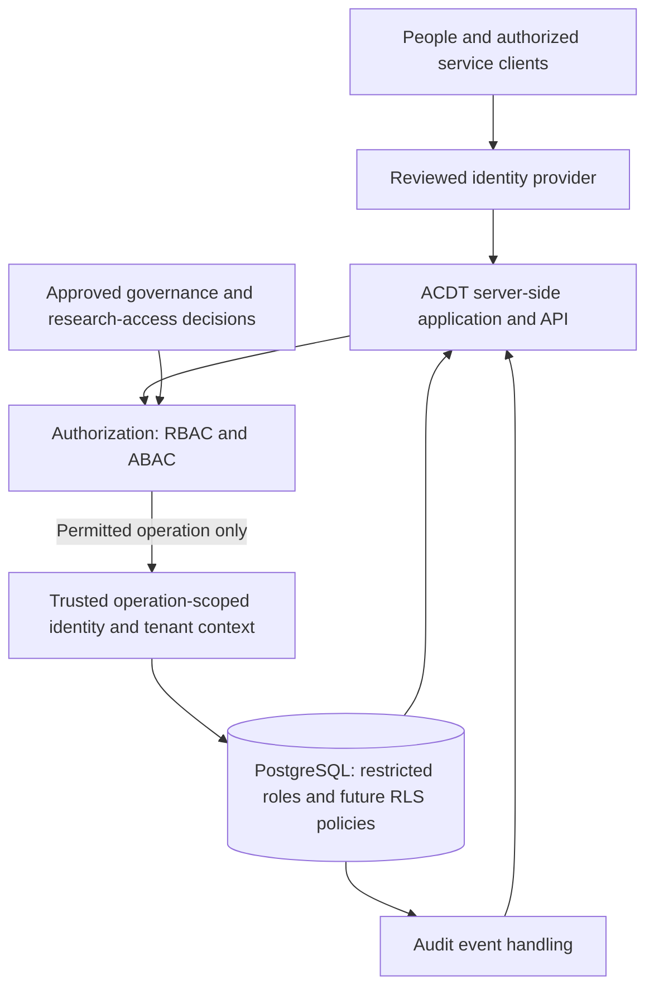

# ACDT Phase 2B.2 — Identity and Access-Control Architecture

**Status:** PROPOSED — design only; not implemented or approved for real-data use  
**Project:** Africa Community Data Trust (ACDT)  
**Relationship to M1:** Complements, and does not replace, `m1-database-security-design.md`.

## 1. Executive summary

This document proposes how people and authorized services would establish identity, how ACDT would authorize protected actions, and how verified identity and organization context could be conveyed to the database.

ACDT remains an early-stage, Nigeria-first, community-centred public-interest research initiative and prototype architecture. It is not an operational data trust, established governance authority, production research platform, certified service, or live community pilot.

The reviewed repository evidence shows a PostgreSQL-oriented migration and documentation, but no implemented web application, API, authentication provider, application authorization service, operational database connection, deployment, or production security controls. This is a target design, not a description of working functionality.

Core principles:
- Authentication establishes account identity; it does not itself authorize access to ACDT data.
- Authorization is enforced server-side for every protected operation.
- RBAC is combined with contextual ABAC.
- Organization membership, project assignment, purpose, consent state where applicable, approval, grant scope, and expiry are evaluated as relevant.
- Requester, independent reviewer, and technical operator are distinct verified people for the same protected request.
- Client-supplied organization identifiers, role names, or claims are not proof of authorization.
- Database privileges and RLS independently constrain database access.
- A custom PostgreSQL setting alone is not a trusted identity assertion.
- Missing, stale, invalid, ambiguous, or unverifiable authorization context fails closed.
- Governance authority, lawful basis, valid consent, and research-ethics approval cannot be created by software.

**Design-readiness position:** For owner, privacy, governance, and independent security review only. Not implementation approval, production readiness, legal compliance, community approval, or permission to process real data.

## 2. Scope and boundaries

### In scope
Identity-provider criteria; registration, invitation, verification, authentication and recovery; credential/MFA requirements; session and token lifecycle; stable principal/account mapping; proposed roles and permissions; RBAC/ABAC; API security; organization membership and project scope; service identities; privileged access; suspension and revocation; relationship to M1; threat and test requirements; open decisions.

### Out of scope
Selecting/configuring a live provider; implementing login, MFA, sessions, APIs, authorization middleware, database tables, migrations, RLS policies, roles, grants, signing keys, key-management services, or deployment; connecting a live database or external identity service; processing real data; establishing a Council or appointing decision-makers; legal opinions, compliance determinations, certifications, or ethics approvals.

## 3. Current-state evidence and limitations

| Component | Current evidence/status |
|---|---|
| Web application | No tracked implementation identified in reviewed repository state; `apps/web/` reported empty |
| API/service layer | No implemented API routes or backend service identified |
| Authentication | No auth code, provider configuration, or login workflow identified |
| Application authorization | No implemented application role model or server-side authorization logic identified |
| PostgreSQL migration | One migration defines six tables |
| RLS | Enabled on six existing tables; no explicit `CREATE POLICY` statements identified |
| Trusted identity | No implemented principal/account mapping or trusted tenant-context mechanism identified |
| Database deployment | No running database or verified application connection established |
| Security operations | No verified production monitoring, incident response, key management, backup, or recovery operation established |

Phase 2A working-tree work includes a synthetic fixture generator, fixture files, and Python tests. The user reported running nine Python unit tests successfully. This does not establish that PostgreSQL was installed, that the migration was executed, or that database access-control behaviour was tested. M1's proposed PostgreSQL security tests remain unrun.

Repository files and local unit-test results are not proof of a live service or production capability.

## 4. Proposed architecture

1. A person or authorized service client initiates a request.
2. A reviewed identity provider authenticates the account.
3. ACDT resolves the account subject to a stable principal/person record.
4. The server checks account status, organization membership, role assignments, project assignment, and purpose restrictions.
5. The server evaluates consent, research approval, grant scope, expiry, and separation of duties where applicable.
6. The server establishes an operation-scoped trusted database context using a separately reviewed mechanism.
7. PostgreSQL applies restricted database privileges and approved RLS policies.
8. Security-relevant outcomes are recorded through the approved audit design.
9. The application returns only the minimum authorized result.

All components and connections are proposed; the diagram does not represent existing integrations.

## 5. Identity model and provider selection

Distinguish:
- **Account subject:** identifier assigned by an identity provider.
- **ACDT account link:** trusted record linking an external account subject to an ACDT principal.
- **Principal/person:** stable identity for accountability and separation-of-duties checks.
- **Organization membership:** current authorized relationship between a principal and an organization.
- **Role assignment:** role granted to a principal within an approved scope.

An account identifier is not necessarily a unique human identity. Multiple accounts mapped to the same principal are the same person for separation-of-duties checks. Shared accounts must not be used for privileged actions. The method for verifying different people and the authority approving account links remain open decisions.

No identity provider is selected. Evaluate candidates for security track record; authentication standards; MFA and phishing resistance; recovery, session, token and revocation features; privacy terms, data location and subprocessors; availability and exportability; integration; cost; audit logs; accessibility; and operational ownership. Provider selection is an owner decision.

## 6. Authentication requirements

A future account process should use an approved registration or invitation route, verify the account communication channel where appropriate, record who authorized activation, and require stronger identity verification where privileged roles or person-level separation depend on it. Email verification alone is not proof of legal identity or governance authority.

If passwords are managed directly, use an appropriately reviewed password-hashing mechanism. Never store plaintext passwords or expose credentials in logs, source control, or frontend code. Recovery should use short-lived, single-use or otherwise replay-resistant mechanisms, rate limits, and appropriate notifications. Recovery must not silently bypass MFA or privileged-role approval.

MFA requirements must be established by an approved risk policy. Privileged accounts, identity administrators, database administrators, and accounts able to approve or execute sensitive access operations require stronger authentication protection. Consider phishing-resistant methods for high-impact roles. Recovery factors and emergency access require controls and auditability.

A future implementation should address rate limiting, credential-stuffing detection, unusual sign-in monitoring, secure recovery, session fixation, replay, phishing, generic external errors where appropriate, and accountable incident response. These are proposed requirements, not deployed controls.

## 7. Session and token security

The selected architecture must define session binding; token issuer, audience and expiry; refresh-token rotation and reuse detection if applicable; idle and absolute timeouts; logout and server-side invalidation; revocation after suspension or role/membership removal; reauthentication for high-impact actions; concurrent-session policy; secure cookie attributes if cookies are used; CSRF protection where relevant; and prevention of secrets in logs, URLs, browser storage exposed to scripts, or source control.

Exact lifetimes remain open until provider, application architecture, risk model, and operations are selected. Cached browser state or an unexpired token must not override current server-side suspension, membership revocation, expired grant, or required authorization rechecks.

## 8. Authorization model

### 8.1 RBAC and ABAC

RBAC establishes actions associated with a role. ABAC evaluates context such as principal, organization, project, assignment, purpose, consent, request state, grant state, data tier, and expiry. A role is not a universal permission. A researcher role does not authorize access to every organization's records or every dataset. Missing, conflicting, stale, or unverifiable attributes result in denial.

### 8.2 Proposed roles

These are conceptual roles only; they do not establish appointments, membership, authority, or accounts.

| Proposed role | Intended responsibility | Boundary |
|---|---|---|
| Project Owner | Strategic, contractual, project-level accountability | No automatic unrestricted participant-data access or unilateral community authority |
| System Administrator | Technical administration and account support | No research-approval authority merely by virtue of technical status |
| Governance Council | Governance oversight and delegated decisions, if legitimately established | No Council is currently constituted; mandate must be legitimate |
| Research Institution | Institutional sponsorship and representation | Affiliation alone grants no participant-data access |
| Principal Investigator | Submits and manages research proposal | Cannot approve own request or execute own grant |
| Researcher | Conducts research within approved scope | Cannot exceed approved purpose, cohort, data tier, organization, or period |
| Data Protection Adviser | Privacy and data-protection advice | Advisory status does not automatically grant data access |
| Community Representative | Represents community interests through a legitimate process | No automatic authority to consent for individuals |
| Data Steward | Approved data-handling responsibilities | Cannot override governance, consent, or access decisions |
| Independent Auditor | Authorized independent review | Mandate-bound, minimized and documented access |

Final roles, appointment authority, delegated powers, and conflicts processes require legitimate governance and institutional approval before implementation.

### 8.3 Separation of duties

M1 Sections 7–9 remain authoritative for detailed requester/reviewer/operator separation. This design adopts these requirements:

1. Requester principal differs from reviewer principal.
2. Reviewer principal differs from technical-operator principal.
3. Each actor uses an individually assigned active account mapped to a trusted principal.
4. Multiple accounts belonging to one person do not satisfy separation.
5. Shared accounts are prohibited for privileged actions.
6. Reviewer and operator assignments are active and authorized for the organization and request.
7. The server enforces the rules before recording a decision or activating a grant.
8. Missing or uncertain identity mapping, appointment, membership, or independence results in denial.

A reviewer role does not automatically confer authority to approve every research request. Approval authority must come from an approved governance and research-access process. A system administrator does not gain research-approval authority solely through technical privileges.

### 8.4 Authorization inputs

Evaluate the authenticated account and principal; account status and authentication assurance; current organization membership; role and project assignment; requested action and data tier; stated and approved purpose; consent state where applicable; research decision and conditions; active grant, scope and expiry; person-level separation; and relevant suspension or conflict states.

Consent and lawful basis are distinct. A consent record does not establish the legal basis for all processing, and a role or grant cannot override legal, ethical, or governance restrictions.

## 9. API and server-side security

The browser is an untrusted client. Submitted organization, project, record, or action values are requests for context, not proof of permission. The server derives identity from validated authentication and resolves membership and roles from trusted server-side records.

For every protected operation, the future API/service layer should:
1. Validate authentication session/token, issuer, audience, expiry and relevant claims.
2. Resolve account subject to stable ACDT principal.
3. Confirm account and principal are active.
4. Check current organization membership and role.
5. Check project, request and data scope.
6. Evaluate purpose and workflow requirements.
7. Check current consent and grant conditions where applicable.
8. Enforce person-level separation for approval and grant operations.
9. Establish trusted operation-scoped database context.
10. Execute parameterized operations using restricted credentials.
11. Record required security events and outcomes.
12. Return only the minimum authorized result.

Do not rely on frontend controls, hidden buttons, route obscurity, or client-supplied role claims. Apply input validation, parameterized operations, output minimization, safe errors, request limits, rate limits, and protection against mass assignment of protected ownership, approval, role, or audit fields.

Exports and bulk operations require separate authorization, purpose limitation, traceability, and fixture-label preservation in synthetic testing. Exported data cannot be assumed to remain controlled by the application.

Service-to-service calls require separately assigned, narrowly scoped service identities. Do not reuse human credentials. Protect and rotate service secrets; exclude them from source control and logs. A service identity must not automatically inherit human administrator permissions or bypass ordinary authorization.

## 10. Trusted organization context and database boundary

M1 Section 8 remains the detailed design for trusted tenant context. Its conclusions are:

- **Browser-supplied organization ID or claims:** rejected as proof of authorization.
- **Shared application database role plus custom PostgreSQL setting alone:** insufficient as the sole trust boundary. Transaction-local scope limits persistence but does not prove identity; a role able to issue SQL may set a custom setting.
- **Per-user database principals through a trusted connection broker:** defensible if broker, identity mapping, pooling and role selection are independently tested.
- **Short-lived signed identity/tenant assertion verified by the database:** M1's conditional recommended target. Requires a separately controlled issuer, protected signing keys, vetted database-side verification, audience and expiry checks, replay handling, key rotation/revocation, and live membership validation.

The signed assertion is not implemented or approved merely because it is documented. If the ordinary application can mint arbitrary assertions, the trust boundary collapses. Do not claim a custom GUC is cryptographically trustworthy.

A future implementation must establish and clear trusted context within a transaction and test pooled connection reuse across organizations, including error, timeout, rollback and cancellation paths. Missing, invalid, expired, mismatched or revoked context denies access.

The migration enables RLS on six tables but contains no explicit policies. M1's policies and restricted database-role topology remain proposals. Future implementation must define and test policies, use a restricted app role that is not owner/superuser/`BYPASSRLS`, consider `FORCE ROW LEVEL SECURITY` where appropriate, and review ownership, `PUBLIC` grants, memberships, inherited privileges, `SET ROLE`, default privileges, sequences, functions and active sessions.

PostgreSQL semantics must be stated precisely: with RLS enabled and no applicable policy permitting access, ordinary non-owner roles are denied by default; table owners normally bypass RLS unless `FORCE ROW LEVEL SECURITY` applies; superusers and `BYPASSRLS` roles bypass RLS. No production tenant isolation is established by the current migration.

## 11. Account lifecycle and revocation

| Event | Required response |
|---|---|
| Invitation/registration | Record authorized invitation and verify account as required |
| Account activation | Confirm verification and approved role assignment |
| Membership added | Validate appointing authority and scope |
| Role/project change | Recalculate permissions and invalidate stale context |
| Membership suspension/revocation | Deny protected operations and invalidate relevant sessions/context |
| Account suspension | Block protected operations and revoke/invalidate sessions and tokens |
| Account termination | Revoke sessions, tokens, memberships, role assignments and service access as applicable |
| Reviewer/operator removal | Prevent further actions under that appointment |
| Suspected compromise | Suspend affected access, preserve evidence, initiate incident response |
| Grant expiry/revocation | Deny subsequent access even if a page or prior session remains open |
| Consent withdrawal | Apply M1's approved withdrawal and dependent-grant invalidation process |

Revocation planning includes access and refresh tokens, sessions, identity-provider sessions, memberships, database roles and memberships, grants, ownership, default privileges, active database sessions, pools, exports, recipient copies, backups, and derived datasets. Withdrawal does not automatically establish that every downstream copy can or must be erased; retention and recipient obligations require qualified review.

## 12. Audit and accountability

M1 Section 10 remains the detailed audit design. A future security event should record only necessary information: stable principal and account subject; relevant role/assignment snapshot; organization/project context; action, target category, timestamp, outcome and correlation identifier; and approval/grant relationship where relevant.

Do not log passwords, tokens, signing secrets, full consent narratives, or unnecessary personal data.

The existing `governance_audit_logs` table and update/delete suppression rules do not establish complete event capture, cryptographic integrity, independent verification, or tamper-proof storage. Privileged actors may alter database rules. Stronger audit controls require separate threat analysis, privileged-access controls, monitoring, independent review, and tested integrity mechanisms.

## 13. Threat model

| Threat | Design response |
|---|---|
| Stolen/reused credentials | MFA, secure recovery, rate limits, monitoring and revocation |
| Account takeover through recovery | Strong recovery controls, notifications and privileged recovery oversight |
| Session/token theft | Secure storage/transport, expiry, rotation, revocation and reauthentication |
| Forged role/organization claim | Derive identity and membership from trusted server-side sources |
| Cross-organization access | Independent application checks, database-verifiable context, explicit RLS and negative tests |
| Privilege escalation | Least privilege, controlled role assignment, review of inherited/database privileges |
| Self-approval | Stable person-level identity comparison and server-side separation checks |
| Shared account/collusion | Individual accounts, appointment controls, audit, conflict rules and independent oversight |
| Compromised application service | Restricted DB role, protected secrets, scoped service identities, monitoring and response |
| Compromised privileged DB account | Separate administration, time-limited access, independent logging/review and recovery planning |
| Pooled tenant-context leakage | Transaction-scoped context and cross-tenant pool-reuse tests |
| Audit manipulation | Restricted audit access, independent integrity controls and privileged-threat review |
| Unauthorized export | Separate export authorization, minimization, traceability and recipient controls |
| Stale consent/grant state | Revalidate current consent, membership, approval, grant and expiry |
| AI-assisted disclosure or decision misuse | Minimize provider data; human review; no autonomous consent, access, governance or benefit-sharing decisions |

This is a design-level starting point, not a completed independent threat assessment or security test.

## 14. Security test strategy

M1 Section 12 defines 24 proposed future disposable PostgreSQL security tests (T01–T24). They remain unrun and are retained as the database-security test baseline.

Phase 2B.2 adds proposed future authentication/application tests:

| ID | Scenario | Expected result |
|---|---|---|
| A01 | Missing, malformed, expired, wrong-issuer or wrong-audience token | Deny protected operation |
| A02 | Disabled/suspended account with otherwise valid session | Deny protected operation |
| A03 | Client changes organization, role, project or record identifier | Server validates scope; no unauthorized disclosure/mutation |
| A04 | Organization member lacks required role | Deny |
| A05 | Role exists but membership/project assignment is revoked | Deny |
| A06 | Stale browser/session state after role or membership change | Current server-side state prevails |
| A07 | Reused/revoked/rotated refresh token | Apply approved replay policy and deny unauthorized reuse |
| A08 | Logout or account suspension | Invalidate applicable sessions/tokens |
| A09 | Expired or reused password-reset/recovery token | Deny and record outcome |
| A10 | Privileged action without required MFA assurance | Require step-up or deny |
| A11 | Service identity acts outside scope | Deny and record |
| A12 | API mass-assigns role, owner, approval or audit fields | Reject protected-field modification |
| A13 | Two accounts mapped to one principal attempt separation | Deny |
| A14 | Authorization service or trusted context cannot be verified | Fail closed |
| A15 | Export exceeds approved purpose or scope | Deny/constrain and preserve traceability |

Use synthetic records in a disposable isolated environment. Authentication tests, Python unit tests, and PostgreSQL RLS/privilege tests must be reported separately. Passing Python tests do not prove authentication security or database isolation.

## 15. Owner decisions and external review

All remain open unless formally decided by an authorized person/process:

| Decision | Required authority/review |
|---|---|
| Identity provider and hosting | Project owner with privacy, security, cost and operational review |
| Registration and identity proofing | Authorized owner and qualified privacy/security reviewer |
| MFA and recovery policy | Security/operations owner and independent reviewer |
| Session/token policy | Security architect and application owner |
| Appointment of reviewers/operators | Legitimate community-defined governance process and relevant institutional input |
| Person identity/account-link verification | Authorized identity authority and privacy/security reviewer |
| Role definitions and delegation | Legitimate governance and institutional processes |
| Organization membership verification/revocation | Named authorized administrators under an approved process |
| Trusted tenant-context approach | Security architect, DBA, identity authority and independent reviewer |
| PostgreSQL version, roles, RLS and migrations | Database/security owner and independent technical reviewer |
| Service identity ownership and secret rotation | Named operations/security owner |
| Lawful basis, NDPA/NDPC and rights | Qualified Nigerian legal/data-protection reviewer |
| Research ethics and institutional approval | Competent ethics/institutional bodies where applicable |
| Community representation and Council mandate | Affected communities through a legitimate process |
| Retention, deletion, backups, exports and derived data | Accountable controller/processor roles with legal/community review |
| Incident response and operations | Named security/operations owner |
| Independent security assessment | Reviewer appointed through an appropriate independent process |

Community consultation or a proposed Council does not automatically establish individual consent or authority to consent for individuals. Research-ethics review is required where applicable to the actual protocol; it is not automatically required for every technical design activity.

The Nigeria Data Protection Act 2023 and relevant NDPC guidance require qualified applicability and obligations review. This document is not a compliance determination. GDPR or other foreign law applies only where its jurisdictional conditions are met and must be assessed by qualified counsel.

## 16. Implementation-readiness gates

No implementation begins until the owner explicitly authorizes the relevant scope and dependencies are resolved. Before real-data use or a pilot, establish legitimate community governance; qualified legal/data-protection review; appropriate ethics/institutional approvals where applicable; approved lawful basis and participant-rights processes; verified identity and appointment processes; independently reviewed authentication and authorization; explicit tested database policies and least-privilege roles; encryption/key management; retention, deletion, backup, recovery and incident response; and operational ownership, monitoring, support and decommissioning.

A synthetic-data-only MVP, if separately approved, must remain isolated and is not authorization to process real participant data.

## 17. Relationship to existing documents

- `docs/architecture.md`: high-level conceptual architecture.
- `docs/privacy-and-security.md`: cross-cutting privacy/security principles.
- `docs/supporting-docs/m1-database-security-design.md`: detailed database, RLS, tenant context, separation of duties, audit and PostgreSQL security-test design.
- `docs/implementation-status.md`: repository evidence and implementation status.
- This document: identity, authentication, application authorization, API security, account lifecycle, and related threats/tests.

If a future change conflicts with M1's detailed database security requirements, the conflict must be explicitly reviewed and resolved. This document does not silently override M1.

## 18. Design conclusion

The proposed Phase 2B.2 architecture is ready for owner, privacy, governance, and independent security review, subject to open decisions and consistency checks. It does not establish authentication, MFA, sessions, application authorization, a trusted identity issuer, RLS policies, operational audit integrity, or production security controls. It does not authorize implementation, deployment, real-data use, or a pilot.

**Final status: PROPOSED — DESIGN ONLY; OWNER ACCEPTANCE AND EXTERNAL REVIEW PENDING.**
